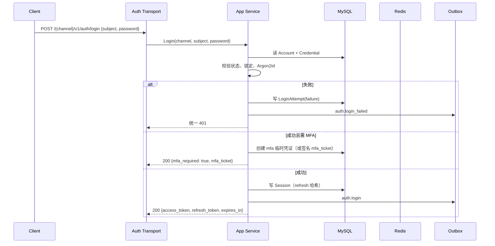
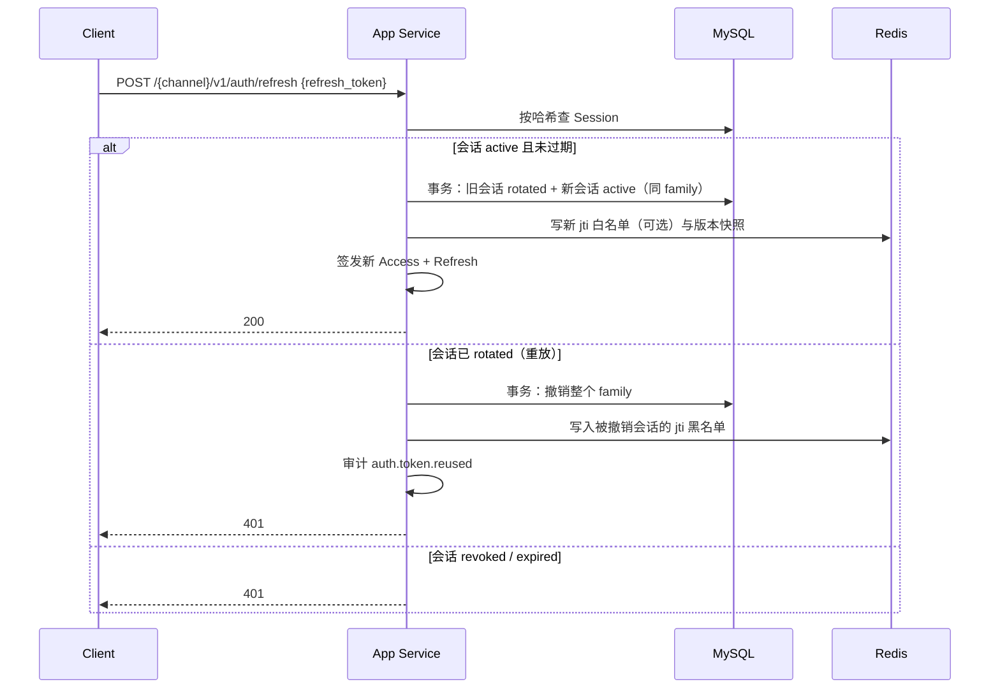

# 身份域与令牌生命周期（Identity & Authentication）

> **状态**：设计生效（v0.1，2026-10-23）；`ENT-01` 阶段 1（账号域）～阶段 5（收口）已全部完成；2026-11-10 增补 SCIM 2.0 与 M2M 设计；§21.1 SCIM 与 §21.2 M2M 均已实现并接入 `check-authn` 门禁（配置 / 领域 / 迁移 `000027`～`000029` / 仓储 / 用例 / 协议端点与管理端点 / 审计与指标 / 角色投影）
> **定位**：定义账号域、凭据、会话、令牌签发与撤销、A 端 MFA、三端认证契约；解决「只有验签、没有登录」的上线阻断问题
> **适用范围**：`internal/identity/`、`internal/security/`、`internal/shared/{auth,audit,apperr}`、`internal/platform/`、`pkg/{jwt,totp,password,crypto,redis,sms}`、`cmd/`、`migrations/`、`api/openapi/`、`scripts/ci/`、`docs/`
> **关联**：[`production-readiness-gaps.md`](./archive/platform/production-readiness-gaps.md) `ENT-01`、[`production-readiness-implementation-plan.md`](./production-readiness-implementation-plan.md) `ENT-01`、[`ARCHITECTURE.md`](./ARCHITECTURE.md) §10、[`rbac-iam.md`](./rbac-iam.md)、[`SECURITY_STANDARDS.md`](./SECURITY_STANDARDS.md) `SEC-04`、[`API_STANDARDS.md`](./API_STANDARDS.md)、[`CONFIG_STANDARDS.md`](./CONFIG_STANDARDS.md)、[`DATA_STANDARDS.md`](./DATA_STANDARDS.md)、[`AUDIT_STANDARDS.md`](./AUDIT_STANDARDS.md)、[`TESTING_STANDARDS.md`](./TESTING_STANDARDS.md)、[`RELIABILITY_STANDARDS.md`](./RELIABILITY_STANDARDS.md)、[`docs/audit/EVENTS.md`](./audit/EVENTS.md)
> **最后更新**：2026-11-10（补收口：`ResourceTypes/{id}` / `Schemas/{id}` 单项发现端点、路由改字面量注册以恢复 `tests/contract` 双向对账、`group_role_map` 缺少投影实现时启动失败；同日 §21.1 SCIM 实现落地：`identity_scim_token` / `identity_scim_group` / `identity_scim_group_member` 与 `provider` 扩宽、`/admin/scim/v2/*` 协议端点（Users / Groups / 发现 / `/Bulk` 501）、A 端三个管理端点、`ScimRoleProvisioner` 角色投影、审计 `auth.scim.*` 与 `identity_scim_*` 指标；同批完成 §21.2 M2M）
> **变更方式**：调整领域模型、撤销语义、表结构或验收标准须同步更新 [`production-readiness-implementation-plan.md`](./production-readiness-implementation-plan.md) 与 [`production-readiness-gaps.md`](./archive/platform/production-readiness-gaps.md)，经架构 Owner 与安全 Reviewer 评审后合入

---

## 目录

1. [结论与范围](#一结论与范围)
2. [设计前缺口（已闭环）](#二设计前缺口已闭环)
3. [领域模型](#三领域模型)
4. [令牌模型与密钥轮换](#四令牌模型与密钥轮换)
5. [登录、刷新与登出](#五登录刷新与登出)
6. [撤销与会话失效](#六撤销与会话失效)
7. [A 端 MFA 与 SSO](#七a-端-mfa-与-sso)
8. [C 端登录](#八c-端登录)
9. [数据模型与迁移](#九数据模型与迁移)
10. [配置规划](#十配置规划)
11. [审计事件](#十一审计事件)
12. [接口契约](#十二接口契约)
13. [平台接入与分层](#十三平台接入与分层)
14. [任务拆解](#十四任务拆解)
15. [验收标准与用例](#十五验收标准与用例)
16. [门禁](#十六门禁)
17. [风险与回滚](#十七风险与回滚)
18. [实施阶段与状态](#十八实施阶段与状态)
19. [多租户边界与扩展模型](#十九多租户边界与扩展模型biz-09)
20. [错误码与本地化](#二十错误码与本地化biz-05)
21. [企业身份扩展：SCIM 2.0 与 M2M](#二十一企业身份扩展scim-20-与-m2m)

---

## 一、结论与范围

### 1.1 结论

平台当前只具备**令牌校验侧**能力：`internal/security` 可验证 HS256 / RS256、`iss` / `aud` / `exp`，但没有任何账号实体、登录端点或会话失效手段。令牌一旦签发，在过期前无法撤销，无法接入真实用户。

`ENT-01` 要补齐的是「身份域是平台底座的一部分」，不是业务功能：

- 账号、凭据、会话、MFA、登录审计由 `internal/identity` 承载；
- 角色 / 权限 / 数据范围仍由 IAM 承载，两张表不互相复制；
- 令牌只表达「你是谁」，不表达「你能做什么」（避免撤权滞后）。

### 1.2 范围

| 纳入 | 说明 |
|---|---|
| 账号域 | `Account`、`Credential`、`Session`、`MFAEnrollment`、`LoginAttempt` 与状态机 |
| 三端令牌 | Access JWT + 一次性 Refresh Token；三端 issuer / audience / 密钥隔离 |
| 生命周期 | 登录、刷新、登出、单会话撤销、全端撤销、账号禁用 / 锁定 |
| 撤销 | 账号级 `token_version` + 会话级 `authn:sid` 快照 + 单会话 `jti` 黑名单 |
| A 端 | TOTP MFA、会话管理；OIDC / SSO 预留接口与开关 |
| C 端 | 短信验证码登录、OAuth 授权码登录；防枚举、防刷 |
| 审计 | 登录、登出、刷新、重放、撤销、MFA、锁定事件的 Outbox 落库 |

| 不纳入 | 原因 |
|---|---|
| 自建完整 IdP、用户目录同步 | 优先复用组织 OIDC；身份域只做账号映射与会话策略 |
| 角色 / 权限判定 | 归 IAM；令牌不固化角色 |
| 账号自助注册的风控体系 | 仅提供可开关的 C 端自动建号与基础限流 |
| 短信 / OAuth 供应商选型 | 复用 `pkg/sms` 与标准 OAuth2 客户端，供应商由配置决定 |

---

## 二、设计前缺口（已闭环）

设计启动时仅有可复用原语（JWT 验签、密码哈希、Redis 缓存/锁、Outbox、审计事件），账号实体、会话表、令牌签发编排、撤销检查与三端认证端点均缺失。上述缺口已由 §三～§十三 落地，当前实现状态见 §十八。

迁移编号按领域合并：身份表 `000001`，IAM 结构 `000002` / 种子 `000003`，平台 async `000004`，MFA bootstrap `000005`。

---

## 三、领域模型

包路径：`internal/identity/{domain,app,infrastructure,transport}`。领域层不依赖框架、数据库与 `internal/platform`。

### 3.1 聚合与实体

| 实体 | 关键字段 | 不变量 |
|---|---|---|
| `Account` | `ID`、`Channel`、`Subject`、`DisplayName`、`Status`、`TokenVersion`、`MerchantID`、`PasswordUpdatedAt`、`DeletedAt` | `(channel, subject)` 全局唯一；`token_version ≥ 1` 且只增不减；禁用账号任何登录路径均拒绝；`DisplayName` 仅用于展示（≤64 rune、禁控制字符、空串回退 `subject`），改名不递增 `token_version` |
| `Credential` | `AccountID`、`Type`、`Hash`、`Algorithm`、`UpdatedAt` | 同一账号同一类型仅一条有效凭据；只存哈希，不存明文 |
| `Session` | `ID`、`AccountID`、`FamilyID`、`RefreshHash`、`Status`、`TokenVersion`、`ExpiresAt`、`RevokedAt`、`RevokedReason` | `RefreshHash` 全局唯一；`rotated` 会话不可再次使用；同一 `FamilyID` 共享撤销量 |
| `MFAEnrollment` | `AccountID`、`SecretCiphertext`、`ConfirmedAt`、`LastUsedStep`、`Version`、`RecoveryCodeHashes` | 未确认的绑定不得用于登录；密钥必须加密存储；同一 TOTP 时间步只能消费一次 |
| `LoginAttempt` | `Channel`、`AccountRef`、`Outcome`、`Reason`、`IPHash`、`UAHash`、`OccurredAt` | 不存明文手机号 / 邮箱 / 密码；保留期遵循审计策略 |

`AccountRef` 为 `subject` 的规范化摘要，用于失败计数与审计关联，禁止直接落明文；生产格式为 `<hash_key_id>:<hex HMAC-SHA256>`（见 §9.5，`IDN-P1-06`），未配置密钥的本地 / 测试环境回退为旧 64 位无前缀摘要。

### 3.2 账号状态机

```text
pending ──激活──► active ──失败阈值──► locked ──到期/解锁──► active
   │                 │                    │
   └──拒绝/清理──► disabled ◄──管理员停用─┘
```

| 迁移 | 触发 | 副作用 |
|---|---|---|
| `pending → active` | 首次密码 / 验证码 / OAuth 登录成功且策略允许 | 初始化 `token_version=1` |
| `active / pending → locked` | 窗口内失败次数达到 `identity.lockout.max_failures` | 写 `auth.account.locked`（仅本次迁移发一次）；拒绝签发令牌 |
| `locked → active` | 锁定到期（下次失败计数前或登录成功时归一）或管理员解锁 | 下次登录重新计数；窗口内失败仍可再次锁定 |
| `active / locked → disabled` | 管理员停用 | `token_version++`、撤销全部会话、写 `auth.account.disabled` |
| `disabled → active` | 管理员恢复 | 不恢复旧会话；用户必须重新登录 |

**状态迁移必须有表驱动用例**：合法迁移成功、非法迁移返回稳定错误、每次迁移产生预期审计事件。

**失败计数规则**（`IDN-P0-03`）：

- 失败计数优先使用 Redis `INCR + EXPIRE`（键 `authn:fail:<channel>:login_fail:<account_ref>`，跨副本共享）；Redis 不可用时回退 `identity_login_attempt` 表计数，保持锁定能力。
- 锁定到期后状态仍为 `locked`：下一次失败计数前必须先归一为 `active`，再按窗口重新计数；窗口内失败仍达到阈值时重新锁定，禁止「到期后永久放行」。
- `pending` 账号允许登录，也必须允许被锁定，避免未激活账号被无限试密码。
- 版本冲突按并发收敛处理：重读后以最新状态为准，返回 `40100`，不得因锁冲突返回 `500`。
- `auth.account.locked` 只在真正发生 `active/pending → locked` 迁移时写一次；已锁定账号的后续失败只写 `auth.login_failed(reason=locked)`。

### 3.3 会话状态机

```text
active ──刷新──► rotated
  │                 │
  ├──登出/撤销──► revoked
  └──到期──────► expired
```

- 刷新只允许 `active → rotated`，并在同一事务内创建新会话（同一 `FamilyID`）。
- 已 `rotated` 的刷新令牌再次出现，视为重放：整个 `FamilyID` 置 `revoked`，可配置是否同时 `token_version++`。
- `revoked` / `expired` 会话永不复活。

### 3.4 领域错误

领域层返回稳定哨兵错误，由应用层映射为 `internal/shared/apperr`：

| 场景 | 语义 | 对外码 |
|---|---|---|
| 账号不存在 / 密码错误 / 验证码错误 | 统一「认证失败」，不区分原因 | `40100` |
| 账号锁定 / 禁用 | 认证失败，审计记录真实原因 | `40100` |
| MFA 未完成 | 认证未完成，返回 `mfa_required` | `40100` |
| 刷新令牌重放 | 会话撤销 | `40100` |
| 登录 / 发送验证码超限 | 限流 | `42900` |
| 撤销存储不可用（`fail_closed`） | 依赖不可用 | `50300` |

---

## 四、令牌模型与密钥轮换

### 4.1 Access Token

| 声明 | 来源 | 说明 |
|---|---|---|
| `sub` | `Account.ID` | 稳定主体 ID，不随渠道变化 |
| `iss` | `auth.jwt.issuer` | 身份域统一 issuer；三端通过 audience / 密钥隔离 |
| `aud` | `auth.jwt.audience` | 必须只包含本端 channel，跨端令牌 401 |
| `iat` / `exp` | 签发时间 / `identity.access_ttl` | 默认 15 分钟 |
| `jti` | 雪花 ID 或随机 ULID | 单会话撤销与重放检测的键 |
| `ver` | `Account.TokenVersion` | 账号级撤销；校验时与 Redis / DB 比较 |
| `channel` | 进程 channel | 与 `aud` 双重校验 |
| `token_use` | 签发场景 | 用户令牌写 `user`；M2M 令牌写 `client`（§21.2.3）。旧令牌缺省该声明时按用户令牌处理 |
| `merchant_id` | `Account.MerchantID` | 仅 B 端携带 |
| `roles` | **禁止签发** | 角色由 IAM 快照解析，避免撤权滞后 |

签发约束：

- `exp - iat` 必须等于配置值，禁止由调用方任意指定。
- 同一账号同一时刻可存在多个 `jti`（多设备）；单会话撤销只影响对应 `jti`。
- 令牌原文禁止进入日志、Trace、指标标签与审计 `attrs`。

### 4.2 Refresh Token

- 32 字节密码学随机数，Base64URL 编码，不携带业务语义，不使用 JWT。
- 出参只出现一次；库内仅存 SHA-256 哈希，按哈希比较，避免时序侧信道。
- 前缀区分端别（如 `ar_` / `br_` / `cr_`），便于日志排查时识别类型而不泄露内容。
- 默认有效期 168 小时（`identity.refresh_ttl`）；支持 `session.idle_timeout` 空闲上限。
- 设备另受绝对生命上限 `identity.session.absolute_ttl`（默认 720h）约束：每次刷新只能在该上限内滑动，超限后刷新返回 `40100` 并撤销整条设备链。

### 4.3 密钥环与 `kid`

现状 `pkg/jwt` 不支持 `kid` 头。`T4` 需要扩展：

```yaml
auth:
  mode: jwt
  jwt:
    alg: RS256
    issuer: https://identity.example.com
    audience: [admin]
    active_kid: "2026-10"
    leeway: 30s
    keys:
      - kid: "2026-10"
        public_key_file: /etc/admin-frame/jwt-2026-10.pub.pem
        private_key_file: /etc/admin-frame/jwt-2026-10.key.pem  # 仅签发进程挂载
      - kid: "2026-07"
        public_key_file: /etc/admin-frame/jwt-2026-07.pub.pem
```

规则：

- 签发只在 header 写入 `active_kid`；校验按 `kid` 选中密钥，未知 `kid` 直接失败（不遍历猜测）。
- 轮换期同时保留新旧公钥；旧私钥卸载后，旧令牌自然过期即完成切换。
- HS256 保留 `secret` / `secrets` 兼容路径，但生产推荐 RS256；同一进程不得同时使用两种算法签发。
- `internal/security.JWTConfig` 增加 `ActiveKID`、`Keys`，并保持旧字段可用（弃用标注）；`Validate` 校验 `active_kid` 必须存在于 `keys`，签发进程必须能读取私钥。

### 4.4 三端隔离

| 端 | audience | issuer | 密钥 |
|---|---|---|---|
| A 端 | `admin` | 身份域统一 issuer | 独立密钥对 |
| B 端 | `biz` | 同上 | 独立密钥对 |
| C 端 | `c` | 同上 | 独立密钥对 |

- 任一端的密钥泄露不得影响其他端。
- 校验端同时检查 `aud` 与 `channel` 声明；两者任一不匹配均 `40100`。
- 禁止用 A 端令牌访问 B/C 端（`AC-ENT-01-3`）。

---

## 五、登录、刷新与登出

### 5.1 登录（密码，A/B 端）



要点：

- 账号不存在与密码错误返回同一文案、同一状态码、近似耗时，防枚举。
- 时序对齐（`IDN-P2-04`）：账号不存在、无密码凭据、`locked` / `disabled` 分支在返回统一 `40100` 前，都会对启动时预计算的占位哈希执行一次真实校验（`PasswordService.VerifyDummy`），使耗时与真实密码校验一致；残余差异仅剩登录尝试 / 审计写入与网络噪声。
- 失败计数按 `(channel, account_ref)` 累计；达到阈值转 `locked`，写审计。
- 登录成功后若 `NeedsRehash` 为真，在事务内透明升级密码哈希。
- 登录失败不创建会话；成功但需 MFA 时也不创建正式会话，只返回短期票据。

### 5.2 刷新



约束（`AC-ENT-01-2`）：

1. 刷新令牌**一次性使用**：每次刷新都轮换，旧令牌立即失效。
2. 并发刷新使用数据库行锁或乐观锁；只有一个请求成功，其余按重放处理。
3. 重放触发**整条会话链**撤销，并记录 `auth.token.reused`，而不是只拒绝当前请求。
4. 刷新不改变 `token_version`；仅登出全部 / 禁用 / 改密才递增。
5. 令牌代过期时间取 `min(now + refresh_ttl, 设备绝对到期时间)`；达到设备绝对上限后拒绝刷新并撤销该设备。

### 5.3 登出

- 默认 `logout`：撤销当前会话（`status=revoked`），写 `authn:sid:<session_id>` 使该会话的 Access Token ≤60s 失效，并把当前 Access 的 `jti` 写入 `authn:revoked:<jti>`（TTL 为令牌剩余寿命）。
- `logout_all`：递增 `token_version`、撤销该账号全部会话，写 `authn:ver:<account_id>`。
- 登出幂等：重复登出返回 204，不产生额外审计噪声（或记 `auth.logout` 一次）。

### 5.4 会话边界

- 单账号活跃会话数受 `identity.session.max_per_account` 限制；超限时按最久未使用淘汰并记审计。
- 设备受绝对生命上限 `identity.session.absolute_ttl` 约束；登录 / 刷新响应与会话列表返回 `absolute_expires_at`，刷新不会延长该值。
- 会话列表只返回 `session_id`、创建时间、最后使用时间、绝对到期时间、设备画像（系统 / 浏览器 / 设备形态 / 脱敏 IP）、状态，不返回令牌，也不返回 IP / UA 原文或摘要。
- 管理员撤销会话只需 `session_id`，不接触令牌原文。

---

## 六、撤销与会话失效

### 6.1 Redis 键设计

| 键 | 值 | TTL | 用途 |
|---|---|---|---|
| `authn:ver:<account_id>` | `token_version\|status\|fetched_at` | `identity.revocation.state_ttl`（默认 `min(access_ttl+1m, 60s)`，硬上限 60s） | 账号级撤销；校验令牌 `ver` 与账号状态，`fetched_at` 用于陈旧度判定 |
| `authn:sid:<session_id>` | `status\|revoked_at\|expires_at\|fetched_at` | `identity.revocation.state_ttl`（≤60s） | 会话级撤销；Access Token 的 `sid` 命中且为 `revoked`/`expired` 时拒绝 |
| `authn:revoked:<jti>` | `1` | 令牌剩余寿命 | 单会话撤销 |
| `authn:fail:<channel>:login_fail:<account_ref>` | 失败次数 | `identity.lockout.window` | 登录失败窗口计数；跨副本共享，Redis 不可用时回退登录尝试表 |
| `authn:client_ver:<client_id>` | `token_version\|status\|fetched_at` | `identity.revocation.state_ttl`（≤60s） | M2M 客户端撤销；`token_use=client` 时替代账号级检查（§21.2.3） |

- 所有键统一带环境前缀（复用 `pkg/redis` 的 `KeyPrefix`），跨环境互不影响。
- 写入使用 `SET ... EX`；撤销检查只读，不延长 TTL。
- 版本读取未命中时回源数据库并回填短 TTL；禁止因未命中直接放行（必须先回源）。
- **数据库是唯一事实源，Redis 只做加速层**：命中快照后若 `now - fetched_at` 超过 `state_ttl`（生产上限 60s），必须回源数据库并回填；回源按 `account_id` 合并（singleflight），避免失效瞬间打爆 DB。
- **变更路径统一失效**：禁用、改密、删除、MFA 解绑、`logout_all` 等所有 `token_version` 变更在事务提交后必须经失效器刷新快照；`SET` 失败时回退 `DEL`，使下一次校验必然回源。缓存写入失败只告警（`identity_revocation_cache_write_error_total{op}`），不得把已提交的业务结果改成失败。
- 旧格式快照（缺失 `fetched_at`）一律视为陈旧，首次命中即回源升级格式。

### 6.2 校验链路

`internal/security` 定义消费侧接口（`S-07`）：

```go
// RevocationChecker 由身份域实现，security 只依赖该接口。
type RevocationChecker interface {
    Check(ctx context.Context, claims jwt.Claims) error
}
```

- `NewJWTAuth` 增加 `WithRevocationChecker` 选项；在签名 / `iss` / `aud` / `exp` 通过后执行。
- 返回 `apperr.ErrUnavailable` 时中间件输出 `50300`；返回 `ErrUnauthorized` 时输出 `40100`。
- 校验顺序：签名 → 时间 → issuer / audience / channel → 账号状态 → `token_version` → 会话状态（`sid`）→ `jti` 黑名单。
- `token_use=client` 时跳过账号、会话与 `jti` 黑名单检查，改用客户端快照（`authn:client_ver`）校验 `ver` 与状态；其余步骤一致（§21.2.3）。
- 会话状态：`sid` 命中 `authn:sid` 且为 `revoked` / `expired`（或已过 `expires_at`）时拒绝；`rotated` 放行，保证刷新成功后仍在途的旧 Access Token 不被误杀。
- 会话快照与账号快照共享陈旧度上限：命中后超过 `state_ttl` 必须回源 `identity_session`，回源失败按 `failure_mode` 处理；会话不存在视为确定性拒绝。
- 撤销检查结果不得使用长 TTL 进程内缓存；如需缓存，上限 5 秒且必须可主动失效。

### 6.3 失效时限

| 场景 | 生效路径 | 目标时限 |
|---|---|---|
| 单会话登出 | `authn:revoked:<jti>` + `authn:sid` | 下一次请求立即生效 |
| 管理员 / 用户撤销其它设备 | DB `status=revoked` + `authn:sid` | ≤ 60s |
| 账号禁用 | DB `token_version++` + `authn:ver` + 撤销全部会话 | ≤ 60s（`AC-ENT-01-1`） |
| 修改密码 / 登出全部 / MFA 解绑 | 同账号禁用（事务提交后统一失效快照） | ≤ 60s |
| 快照写入失败 | 回退 `DEL`，下一次校验回源 DB；仍失败由 `state_ttl` 过期兜底 | ≤ 60s |
| 刷新令牌重放 | 撤销 family + 写 `authn:sid`（含已 rotated 的历代会话） | ≤ 60s（已签发 Access Token 同步失效） |
| 角色 / 权限变更 | IAM 快照失效（不属本域） | 既有 IAM 语义 |

### 6.4 故障策略

- `identity.revocation.failure_mode=fail_closed`：Redis 不可用返回 `50300`，禁止放行；生产强制。
- `fail_open` 仅允许非生产环境，且需在配置评审中说明；启动时 `Validate` 拒绝生产使用。
- 数据库不可用同样失败关闭；禁止「读不到账号就当作有效」。

### 6.5 监控与告警（IDN-P1-03）

- 撤销 / 回源失败必须留痕：`refreshInTx` 在整链撤销失败时返回 `50300` 并回滚事务，禁止只提交 `auth.token.reused` 而未真正撤销。
- 日志为结构化 Error 级，字段只允许 `trace_id`、`channel`、`account_ref` / `family_ref`（摘要）、`reason`、`error_class`；禁止密码、令牌原文、验证码、TOTP 密钥、恢复码与手机号 / 邮箱原文。
- 指标由 `internal/identity/observability` 统一注册，标签只使用低基数枚举值。

| 指标 | 类型 | 关键标签 | 告警建议 |
|---|---|---|---|
| `identity_login_total` | counter | `channel`、`result`、`reason` | 失败率突增（5m 相对基线） |
| `identity_login_duration_seconds` | histogram | `channel` | p99 异常（依赖或 Argon2 排队） |
| `identity_lockout_total` | counter | `channel` | 突增视为暴力破解 / 恶意锁定 |
| `identity_mfa_verify_total` | counter | `result` | 失败率突增 |
| `identity_mfa_recovery_used_total` | counter | — | 任何非零都通知账号所有者并检查恢复码剩余量 |
| `identity_refresh_total` | counter | `result` | 失败率突增 |
| `identity_token_reuse_total` | counter | — | 任何非零立即告警 |
| `identity_session_revoke_total` | counter | `reason`、`result` | 异常批量撤销；`result=failure` 立即告警 |
| `identity_revocation_store_errors_total` | counter | `op` | 任何非零告警（已失败关闭） |
| `identity_revocation_cache_write_error_total` | counter | `op` | 任何非零告警（依赖 ≤60s TTL 兜底） |
| `identity_sms_send_total` | counter | `result` | 失败率 / 发送量突增 |
| `identity_oauth_callback_total` | counter | `provider`、`result` | 失败率突增 |

- 建议告警：`rate(identity_token_reuse_total[5m]) > 0`、`rate(identity_revocation_store_errors_total[5m]) > 0`、`rate(identity_session_revoke_total{result="failure"}[5m]) > 0`、`rate(identity_mfa_recovery_used_total[5m]) > 0`、登录失败率超过基线、锁定量突增、短信失败率或发送量突增。

---

## 七、A 端 MFA 与 SSO

> **适用端别**：MFA 仅 A 端实现。B 端配置 `identity.mfa.admin_required=true` 会在启动校验阶段失败；B / C 端运行时固定按 `false` 处理，不装配 MFA 密文与票据，也不下发强制绑定挑战。启动日志会打印实际生效值，供运维核对。

### 7.1 TOTP

- 新增 `pkg/totp`：HMAC-SHA1、30 秒步长、6 位、允许 ±1 个窗口；仅依赖标准库，不引入第三方。
- 密钥生成 20 字节随机数，Base32 展示；数据库存 **AES-GCM 密文**，密钥来自 `identity.mfa.secret_key`（非生产）或 ENT-07 密钥托管（生产）。
- **TOTP 防重放（IDN-P1-05）**：`identity_mfa.last_used_step` 记录已消费时间步；校验成功时用 `version` 乐观锁 CAS 推进，同一时间步第二次使用按重放拒绝。
- **恢复码（IDN-P1-05）**：10 字节（80 bit）随机数、按 4 位分组展示；存储为 `SHA-256("recovery|<accountID>|<code>")`（账号加盐）；消费使用 `JSON_REMOVE + JSON_SEARCH` 原子删除，禁止“读整表 → 删除 → 写回”。使用后写 `auth.mfa.recovery_used`（含剩余数量）。
- **密钥轮换**：`identity.mfa.keys[]` + `active_key_id` 组成密钥环，密文头携带 key id；旧格式（单 `secret_key`）仍可解密，并在登录成功后自动重加密为 active key。轮换期间必须保留 `secret_key` 作为 legacy 解密回退，确认所有绑定都重加密后再移除。
- 绑定流程：`mfa/setup` 返回密钥与 `otpauth://` URI → `mfa/verify` 校验首个动态码 → 标记 `confirmed_at` → 写 `auth.mfa.bound`。
- 并发：`identity_mfa.version` 作为乐观锁，`Confirm` / 消费时间步 / 解绑与校验冲突时以“已删除”或“已消费”为准，禁止 upsert 复活。

### 7.2 两步登录

- 密码校验通过且账号已绑定 MFA：返回 `200 {"mfa_required": true, "mfa_ticket": "..."}`。
- `mfa_ticket` 是短期 JWT：`aud=admin`、`scope=mfa`、`exp=5m`、`jti` 独立；只允许调用 `mfa/verify`。
- `mfa/verify` 校验票据与动态码后签发正式 Access / Refresh。
- `identity.mfa.admin_required=true` 时：
  - 未绑定 MFA 的 A 端账号登录返回 `200 {"mfa_binding_required": true, "mfa_setup_ticket": "..."}`，不签发管理令牌，由客户端就地引导绑定（§7.2.1）；
  - 已绑定但两步未完成，绝不签发管理令牌（`AC-ENT-01-4`）。
- `mfa_ticket` 重放：一次性消费（Redis `SETNX`），失败次数计入锁定。
- `mfa_setup_ticket` 重放：返回 `40100` 但**不计入失败次数**（避免恶意锁定），仅写 `auth.mfa.ticket_replay`。
- MFA 校验同时使用票据 jti + 账号级双维度限流，防止轮换票据刷码。

### 7.2.1 强制绑定 MFA 的契约与首个管理员 bootstrap

> **状态**：已定稿并落地（D1=①、D2=①、D3=①、D4=角色种子迁移 + 启动引导、D5 按建议实现）。

**登录响应（`POST /admin/v1/auth/login` → `200`）**

```json
{
  "mfa_binding_required": true,
  "mfa_setup_ticket": "<JWT>"
}
```

- 票据声明：`aud=admin`、`scope=mfa_setup`、`sub=<account_id>`、`exp ≤ 10m`、独立 `jti`；`jti` 在 Redis 一次性消费，键与 `mfa_ticket` 隔离。
- 作用域：**只**允许调用 `POST /admin/v1/auth/mfa/setup` 与 `POST /admin/v1/auth/mfa/verify`；携带该票据访问任何其他端点一律 `40100`。
- 校验顺序：每次使用都重新读取账号状态，禁用 / 锁定立即失效，不依赖票据内的快照。
- 限流沿用 `mfa/verify` 的票据维度分桶（`channel + jti + IP`，绑定流程使用独立前缀 `mfa_setup`）；绑定失败计入锁定并写 `auth.mfa.failed`；成功写 `auth.mfa.bound`。
- `setup` 重复调用：覆盖未确认绑定（旧的未确认 enrollment 作废），已确认绑定仍返回 `40900`。
- 成功绑定：返回 `TokenPair`（与两步登录同形），客户端无需二次输密码。
- 审计：`auth.login_failed` 的 `reason` 对「需绑定」继续使用 `mfa_pending`，不新增 reason。

状态机：

```text
未绑定 --密码通过--> setup_required(mfa_setup_ticket)
setup_required --mfa/setup--> pending（密钥与恢复码仅本次可见）
pending --mfa/verify 首码正确--> bound + TokenPair
pending --mfa/verify 失败 N 次--> locked（按锁定策略）
setup_required / pending --票据过期、重放、账号禁用--> 40100，客户端回登录页
```

**契约与 OpenAPI（已合入）**

- 新增 `MFABindingRequired`：`required: [mfa_binding_required, mfa_setup_ticket]`、`additionalProperties: false`、`mfa_binding_required` 枚举 `[true]`；登录 `200` 的 `data.oneOf` 增加该 schema。
- `MFAVerifyRequest` 新增 `mfa_setup_ticket`（与 `mfa_ticket` 互斥，同时出现返回 `40000`）。
- `mfa/verify` 支持无 `Authorization` 的强制绑定流程：成功返回 `TokenPair`；携带 `Authorization` 时仍返回 `204`。
- 新增 `MFASetupRequest`（`additionalProperties: false`，可选 `mfa_setup_ticket`）；`mfa/setup` 请求体可选。
- `mfa_setup_ticket` 禁止写入日志 / Trace。

**首个管理员 bootstrap（迁移 `000005_seed_bootstrap_admin` 角色种子 + A 端启动引导）**

- `000005_seed_bootstrap_admin` 只创建 `iam_role(system_admin)`、逐项权限授权、`all` 数据范围与存量订正；
  首个管理员（`identity_account`、`identity_credential`、`iam_role_binding`、`auth.account.created` 审计）
  由 A 端 `admin-api` 启动时 `identityruntime` 调用 `bootstrap.EnsureAdmin` 在同一事务内幂等创建。
- 迁移脚本不含明文登录主体：账号主体由启动引导用应用密钥计算 HMAC 索引并 AES-256-GCM 加密写入，
  因此迁移可以一次跑完，不需要中途停下等待回填，也不需要独立 CLI。
- 只在账号不存在时创建；已有环境只校验凭据与绑定，不覆盖密码、不改变已确认状态。
- 初始口令是仓库内公开的演练值，因此**依赖强制改密**在首次登录时替换；首次登录顺序为
  「强制改密 → MFA 强制绑定 → 获得管理令牌」，运维全程不接触 TOTP 密钥。
- 登录名固定为系统默认 `admin@example.com`；角色固定 `system_admin`，
  逐项授予生效的 A 端权限并排除 `iam:breakglass:approve`，不写 `*`。
- 引导仅限 A 端且数据库持久化时执行：B/C 端进程与内存库跳过，避免创建跨端账号。
- 回滚 `000005_seed_bootstrap_admin.down.sql` 只删除 `system_admin` 角色及其授权 / 数据范围 / 绑定；
  账号与凭据由启动引导创建，不随迁移回滚删除。

**验收（已并入 §15）**

- `AC-ENT-01-6`：未绑定账号在 `admin_required=true` 下可凭登录返回的 `mfa_setup_ticket` 完成绑定并直接获得令牌，全程无需人工改库。
- `AC-ENT-01-7`：首个管理员由 A 端 `admin-api` 启动引导幂等开通（账号已存在时只校验授权），
  开通审计落 Outbox，口令与 TOTP 密钥不进入日志。
- `mfa_setup_ticket` 不能访问任何业务接口；过期 / 重放返回 `40100` 且不产生绑定副作用。

### 7.3 OIDC（已实现并通过 staging 真实 Keycloak 验收）

- `identity.oauth.providers[]` 的每个 provider 必须显式 `oidc_enabled: true` 才启用 OIDC；默认关闭。
  - 开启时 `issuer` 与 `jwks_url` 必填且必须成对出现，`userinfo_url` 可省略；
  - 关闭时若仍填写 `issuer` / `jwks_url`，启动期校验直接失败，避免隐式启用或配置漂移。
- 流程固定：state + nonce + PKCE（S256）。nonce 由服务生成并写入一次性 state（TTL 10 分钟），回调时回传校验；缺失或与 id_token 不一致统一返回 `40100`。
- id_token 校验：仅接受 `RS256`；校验签名（JWKS，支持 `kid` 未知时限频强制刷新以完成密钥轮换）、`iss`、`aud`（默认 `client_id`）、`exp`/`iat`（默认 30s 时钟偏差）与 `nonce`。
- 主体取自 id_token 的 `sub`；OIDC 模式下不允许回退到 userinfo，避免绕过签名校验。
- 配置项：`audience`（默认 `client_id`）、`jwks_ttl`（默认 15m，范围 `[1m, 24h]`）、`jwks_min_refresh_interval`（默认 1m）、`id_token_leeway`（默认 30s）。
- 可观测性：
  - `identity_oauth_callback_total{provider,result,reason}`：`reason=ok|oauth_invalid|oauth_not_configured|unavailable|rate_limited|internal`；
  - `identity_oauth_jwks_refresh_total{provider,result}`：公钥集刷新成功 / 失败次数；
  - `identity_oauth_jwks_cache_age_seconds{provider}`：距上次成功拉取的秒数，持续增长表示 IdP 不可达或刷新失败。
- 密钥轮换与故障处置（Runbook）：
  - IdP 先在 JWKS 中并行发布新 `kid`，再切换 id_token 签名密钥；旧公钥在缓存 `jwks_ttl` 内仍可验证。
  - 未知 `kid` 会在 `jwks_min_refresh_interval` 限频内强制刷新一次，用于快速收敛轮换。
  - 刷新失败时保留上一份可用公钥：已缓存的 `kid` 继续验证，未知 `kid` 失败关闭（`40100` / `50300`），不降级到 userinfo。
  - `identity_oauth_jwks_cache_age_seconds` 持续超过 `jwks_ttl` 时，检查到 IdP 的网络、证书信任链与 JWKS 端点；恢复后下一次校验自动刷新。
- JWKS 轮换演练（M2 退出条件，需在 staging + 真实 IdP 执行，判定以指标变化为准）：
  1. 基线：完成一次正常登录，确认 `identity_oauth_callback_total{result="ok"}` 递增、`identity_oauth_jwks_cache_age_seconds` 处于 `jwks_ttl` 以内。
  2. 发布新公钥：Keycloak `Realm Settings → Keys → Providers` 新增 RSA provider，优先级高于当前 active key；确认 JWKS 端点同时返回新旧 `kid`，此时业务无需重启。
  3. 切换签名 key：把新 provider 置为 active，使 id_token 使用新 `kid`；在本地缓存仍只有旧公钥时发起一次回调。
  4. 预期：未知 `kid` 触发一次限频刷新，`identity_oauth_jwks_refresh_total{result="success"}` 递增，登录成功；回调耗时突增属预期，下一次恢复缓存命中。
  5. 故障演练（可选）：临时阻断到 JWKS 端点的网络，在已缓存 `kid` 下重复登录应成功；用未缓存 `kid` 时刷新失败返回 `50300`（刷新成功但 JWKS 仍无该 `kid` 时为 `40100`），`cache_age_seconds` 持续增长；恢复网络后下一次校验自动刷新。
  6. 回滚：把旧 provider 重新置为 active，并保留新公钥；删除新 provider 须等所有已签发 id_token 过期后再执行。
- 验收用例：`TestOIDCEndToEndAuthorizationCodeFlow`（授权码 + PKCE + nonce 全链路、授权码重放与 nonce 不匹配拒绝）、`TestJWKSRetainsCacheWhenRefreshFails`（故障期保留旧公钥、未知 kid 失败关闭）、`TestOIDCRequiresExplicitFlag`（显式开关）。
- 验收记录：2026-11-05 在 staging 使用真实 Keycloak 完成 OIDC 冒烟，授权码 + PKCE 登录链路通过；JWKS 轮换演练按上节步骤执行，结果以 `identity_oauth_jwks_refresh_total` 与 `identity_oauth_jwks_cache_age_seconds` 为判定依据。
- 账号映射：`(provider, provider_subject) → account_id`；找不到时按 `identity.oauth.auto_provision` 决定拒绝或建号。
- IdP 侧参数模板：[idp-config-templates.md](./identity/idp-config-templates.md)（Keycloak 26.x 实测基线 + 通用验收清单）。
- SCIM 目录同步与 M2M 客户端凭证见 §21（2026-11-10 已实现，默认关闭）。启用需显式配置并完成 S6-1 安全评审；未启用时相关路由不注册。

---

## 八、C 端登录

### 8.1 短信验证码

- `POST /c/v1/auth/sms/send`：6 位数字验证码，Redis 存哈希，TTL 5 分钟。
- 手机号必须为 E.164（`^\+[1-9]\d{2,14}$`）；账号定位使用 `subject = "phone:" + sha256(手机号)`（hex），库内不落明文手机号。
- 短信驱动 `identity.sms.driver=memory|aliyun`：`memory` 仅本地 / 测试；生产禁止 `memory`，阿里云凭证只从 `ALIYUN_SMS_ACCESS_KEY_ID` / `ALIYUN_SMS_ACCESS_KEY_SECRET` 读取。
- 限制：
  - 单手机号 60 秒内只能发送一次；
  - 单手机号每日上限、单 IP 每小时上限（`identity.sms.*`）；
  - 验证码最多尝试 5 次，超限作废并记审计；
  - 响应恒定（无论手机号是否存在），防枚举。
- 供应商熔断与余额告警（`IDN-P2-05`）：连续可重试故障达到 `identity.sms.breaker_failures`（默认 5）后打开熔断，`breaker_timeout`（默认 60s）内不再触网；模板 / 签名 / 号码等永久拒绝不计入熔断。厂商返回余额不足（如 `isv.AMOUNT_NOT_ENOUGH`）时写 Error 日志并递增 `identity_sms_provider_alerts_total{kind="insufficient_balance"}`。
- 未注册手机号不自动建号：登录端点验证码校验通过但账号不存在时返回 `40100`（与验证码错误一致）。
- `POST /c/v1/auth/sms/register`：验证码通过后在同一事务内创建账号（`subject = "phone:" + sha256(手机号)`）、手机号凭据与 `auth.account.created` 审计，并直接签发令牌；已注册手机号与验证码错误统一 `40100`，并发开户由 `(channel, subject)` 唯一键兜底。
- 日志与审计禁止出现完整手机号；只记录不可逆摘要。

### 8.2 OAuth 授权码

- `POST /c/v1/auth/oauth/{provider}/authorize`：服务端生成一次性 state 与 PKCE verifier（S256），返回授权地址；state 存 Redis，TTL 10 分钟，一次性消费。
- `POST /c/v1/auth/oauth/{provider}/callback`：code + state → 换取令牌；OIDC 模式（`oidc_enabled: true`）下校验 id_token 的 nonce / 签名 / issuer / audience 并取 `sub`，其余模式读取 userinfo（`subject_field`，默认 `sub`）→ 映射账号。
- provider 未配置时不注册路由；state 无效、provider 不匹配、授权码被拒与未映射身份统一返回 `40100`，IdP 故障返回 `50300`。
- 账号映射表 `identity_oauth_identity`，`UNIQUE(provider, provider_subject)`。
- 自动建号受 `identity.oauth.auto_provision` 控制，默认关闭；建号主体为 `subject = "oauth:<provider>:" + sha256(provider_subject)`，避免第三方主体含 PII 或超长。

### 8.2.1 SAML 2.0（SP-initiated，已实现）

- 能力边界：仅支持 SP-initiated SSO 与 HTTP-POST binding；不支持 IdP-initiated、SLO、Artifact binding 与多 IdP 单点登出联动。
- 依赖 `github.com/crewjam/saml`；SP active / next 双密钥支持轮换，metadata 同时发布两张签名 / 解密证书。
- 流程：
  1. `POST /c/v1/auth/saml/{provider}/authorize`：生成 128bit state 与 AuthnRequest ID，AuthnRequest 以 HTTP-Redirect 返回；state 复用 OAuth state store（TTL `identity.saml.request_ttl`，默认 10 分钟，一次性）。
  2. IdP 鉴权后以表单 POST `SAMLResponse` + `RelayState` 到 `POST /c/v1/auth/saml/acs`；仅接受 `application/x-www-form-urlencoded`，请求体上限 512KB。
  3. 校验：必须为加密断言（`EncryptedAssertion`），签名覆盖断言本体；校验 `InResponseTo`（必须与 state 记录的 AuthnRequest ID 一致）、`Issuer`、`Audience` = SP entityID、`Destination`、`NotBefore` / `NotOnOrAfter` / 断言总生命周期（默认 ≤ 5 分钟，时钟偏差默认 2 分钟）。
  4. 断言 ID 在 Redis 以 `saml:replay:<provider>:<sha256(assertion_id)>` 去重（TTL = `assertion_ttl + clock_skew`），冲突返回 `40100`；Redis 不可用失败关闭（`50300`）。
  5. 主体取断言 `Subject.NameID`（格式限定 persistent / transient / unspecified），映射 `(saml:<provider>, subject)` → 账号；未映射时按 `identity.saml.auto_provision` 决定拒绝或建号（默认拒绝）。
  6. 成功后签发一次性 ticket（默认 60 秒，单次消费），以 `303` 跳转 `login_redirect_url?ticket=...`；令牌不进入浏览器地址栏。
  7. 前端 `POST /c/v1/auth/saml/exchange` 用 ticket 换取访问 / 刷新令牌；ticket 过期、已消费或不存在统一 `40100`。
- `GET /c/v1/auth/saml/metadata`：返回 SP 元数据（`application/samlmetadata+xml`），供 IdP 登记 entityID、ACS 与证书。
- 错误码：断言 / state 无效、重放、未映射主体统一 `40100`；`SAMLResponse` 或 `RelayState` 缺失 `40000`；请求体超限 `413`；Content-Type 不符 `415`；IdP 元数据不可达 `50300`；限流 `42900`；provider 未配置 `40400`。
- 可观测性：`identity_saml_authorize_total{provider,result,reason}`、`identity_saml_acs_total{provider,result,reason}`、`identity_saml_acs_duration_seconds{provider,result}`；reason 与 OAuth 共用 `ok|oauth_invalid|oauth_not_configured|unavailable|rate_limited|internal`。
- 安全约束：ACS 日志与审计禁止出现 `SAMLResponse` 原文、断言 ID 原文与 NameID；只记录 provider 与粗粒度原因。SP 私钥仅从密钥托管注入（`identity_saml_sp_private_key` / `identity_saml_sp_private_key_next`），prod / staging 禁止明文 YAML。
- 验收记录（2026-11-06，kind 集群 `af-verify` 等价 staging，真实 Keycloak 26.7.4）：
  - 正向链路（加密断言 + 签名）：`authorize` 200 → Keycloak 登录页 → ACS 303 返回一次性 ticket → `exchange` 200（`expires_in=900`）→ `GET /c/v1/me` 200。令牌头 `kid=saml-verify`、`aud=c`、`iss=admin-frame`；账号主体 `oauth:saml:keycloak:v1:<sha256>`；`identity_oauth_identity` 写入 `provider=saml:keycloak`。
  - Redis 证据：`saml:ticket:used:<ticket>` 与 `saml:replay:keycloak:<sha256(assertion_id)>` 均按预期生成；指标 `identity_saml_acs_total{result="success"}`、`identity_saml_authorize_total{result="success"}` 递增。
  - 负向用例：state 重放 / 篡改断言 / ticket 二次兑换 / 无效 ticket 均 `401` + `40100`；未知 provider `404` + `40400`；JSON Content-Type `415`；缺少 `SAMLResponse` 或 `RelayState` `400` + `40000`；c-api 日志中无 `SAMLResponse`、NameID、SP 私钥原文。
  - IdP 兼容：Keycloak 26 默认使用 XML Encryption 1.1（`rsa-oaep` = RSA-OAEP-256，`DigestMethod` 为 `http://www.w3.org/2001/04/xmlenc#sha256`），crewjam v0.5.1 未注册这两项；SP 侧已补注册（见 `internal/identity/infrastructure/saml/keys.go`），否则解密失败并统一返回 `40100`。IdP 加密算法需选择 `AES-256-CBC` 等 CBC 模式，AES-256-GCM 不受支持。
  - 已知观察（非缺陷）：无效 ticket 兑换会在 Redis 留下 `saml:ticket:used:<ticket>` 标记（TTL 5 分钟），仅产生少量键空间噪声，不影响一次性语义。
- 密钥轮换演练（2026-11-06，同一 Kind 集群，SP 同时配置 active 与 next 双密钥）：
  - 元数据：`GET /c/v1/auth/saml/metadata` 返回 2 个 `use="encryption"` KeyDescriptor（active 在前、next 在后），与 Secret 中 `identity_saml_sp_private_key` / `identity_saml_sp_private_key_next` 一一对应；当前未发布 `use="signing"` 用途（SP 未启用独立签名证书）。
  - 基线（IdP `saml.encryption.certificate` = active）：authorize 200 → Keycloak 登录 → ACS 303 → exchange 200 → `/c/v1/me` 200，令牌头 `kid=rotate`（演练 overlay 的签名 key id）。
  - 切 next：IdP 加密证书改为 next 后 ACS 仍 303、exchange 200。取该次 `SAMLResponse` 的 `EncryptedKey`，以 `rsa-oaep`（MGF1-SHA256）解 RSA 密文得到 32 字节 AES-256 CEK：`next.key` 解出，`active.key` 解密失败，证明命中的是 `spNext` 回退分支（`internal/identity/infrastructure/saml/provider.go` 仅在存在 `EncryptedAssertion` 且 active 解析失败时重试）。
  - 切回 active：旧证书加密的断言继续通过，验证轮换回滚路径。
  - 指标与数据：`identity_saml_acs_total{provider="keycloak",result="success",reason="ok"}=5`，`identity_saml_acs_duration_seconds` 5 次全部落在 ≤ 50ms 桶（累计 0.146s）；`identity_oauth_identity` 中 `provider=saml:keycloak` 共 6 行；Redis 生成对应 `saml:replay:<provider>:*` 与 `saml:ticket:used:*`。
  - IdP 侧接入前提（演练中确认，需写入接入检查表）：
    1. `saml.force.post.binding` 必须为 `true`（Keycloak 默认）。置为 `false` 且 AuthnRequest 携带 `ProtocolBinding=HTTP-POST` 时，Keycloak 以 `invalid_redirect_uri` 拒绝（400）。
    2. AuthnRequest 的 `Destination` 必须与 `KC_HOSTNAME` 完全一致；不一致时 Keycloak 返回 `Invalid Request`（400）。缺失 `Destination` 虽可通过，但不符合规范，不得作为接入方案。
    3. SP 的 AuthnRequest 现在显式请求 `persistent`（`identity.saml.name_id_format`，默认值），同一 IdP 用户的 NameID 稳定；若显式配置为 `transient`，IdP 未强制名称格式（`saml_force_name_id_format=false`）时每次登录 NameID 会变化，`auto_provision` 将重复建号。
    4. 静态 IdP 元数据下，IdP **签名**证书轮换仍需同步更新 SP 侧 `providers[].metadata_xml` 并重部署；本次演练只覆盖 SP 加密证书轮换。
  - NameID 稳定性复测（2026-11-06，同一集群，`name_id_format: persistent`）：同一 Keycloak 用户 `saml-verify` 连续两次完整登录，均 `authorize` 200 → 登录页 200 → ACS 303 → `exchange` 200（`expires_in=900`），两次 JWT `sub` 均为 `377034981391740928`；`identity_oauth_identity` 中 `provider=saml:keycloak` 保持 7 行未新增，证明同一 IdP 主体复用同一账号与绑定。
  - 对照证据（修复前，AuthnNameIDFormat 为空走 crewjam 默认 `transient`）：09:06–09:08 的 5 次登录各生成不同 `account_id`（如 `377020840564240384` / `377020933841367040` / `377020992939110400`），`auto_provision` 每次重复建号。修复后 `ParseNameIDFormat` 对空值默认 persistent，AuthnRequest 的 `NameIDPolicy` 携带 `urn:oasis:names:tc:SAML:2.0:nameid-format:persistent`。
  - 环境已回滚（2026-11-06）：历史 revision 17 已超出保留窗口，改用基线 `values-kind.yaml` 重新 upgrade 恢复（`c-api:verify`、identity 关闭），当前 release 为 revision 34；临时 Secret `admin-frame-saml` / `admin-frame-jwt-signing` 已删除，`/readyz` 200、`/c/v1/auth/saml/metadata` 404（功能随配置关闭）。

### 8.3 限流与防刷

| 端点 | 分桶键 | 默认 |
|---|---|---|
| 登录 | 账号级 `channel:login:<account_ref>` + IP 级 `channel:login::<ip_hash>` | 双维度各 1 rps / burst 5，任一超限即拒绝 |
| 发送验证码 | 手机号级 + IP 级 + 全局日预算 | 每 60s 1 次；单手机号日限、单 IP 时限、`daily_budget` |
| 刷新 | `channel + session 摘要` | 5 rps / burst 10 |
| MFA 校验 | `channel + account + IP` | 1 rps / burst 5 |
| OAuth authorize / callback | 全局 `authorize:global` / `callback:global` + IP 级 | 1 rps / burst 5，Redis `fail_closed`（`IDN-P2-05`） |

- 认证端点不挂全局 `AuthMW`，但必须挂独立限流中间件；限流命中返回 `42900` 并带 `Retry-After`。
- 登录限流有 Redis 时使用 `pkg/ratelimit.NewRedisKeyed` 跨副本共享配额，`identity.login_rate_limit.failure_mode` 生产强制 `fail_closed`；无 Redis 时退化为进程内实现（仅单副本）。
- OAuth 同样使用 `pkg/ratelimit.NewRedisKeyed`（键前缀 `identity:oauth:`），authorize 与 callback 各自检查全局 + 单 IP，防止刷爆 state 键空间。
- 短信发送失败会回滚重发窗口（`ResetResend`），避免用户没收到验证码却被锁在重发间隔内。
- 短信供应商熔断（`IDN-P2-05`）：`pkg/circuitbreaker` 包裹发送调用，打开期间直接 50300；状态迁移写 Warn 日志（provider / from / to）。
- 余额告警：`identity_sms_provider_alerts_total{kind,provider}` 任何非零都应配置告警规则并通知运维；告警日志只含 kind / provider / 厂商码，不含手机号与正文。
- Argon2 并发保护（`IDN-P2-05`）：`identity.password.max_concurrent`（默认 `2×CPU`）限制同时校验数量，`wait_timeout` 内拿不到槽位返回 `50300`，且不计入登录失败、不触发锁定。

### 8.4 客户端 IP 与可信代理（IDN-P1-04）

- 统一由 `pkg/httpx.ClientIPResolver` 解析客户端 IP：只有 `http.trusted_proxies`（CIDR 列表）内的请求才解析 `X-Forwarded-For`，并从右向左跳过可信代理取第一个不可信地址。
- 未配置可信代理或来源不可信时忽略 XFF，直接使用 `RemoteAddr` 并去掉端口；IPv6 统一为规范文本，保证同一地址的不同连接共享限流键。
- identity 的 A/B/C 端 Handler 与平台级 `rate_limit` 共用同一解析器，禁止各自实现 XFF 解析。

---

## 九、数据模型与迁移

### 9.1 迁移

- 文件：`migrations/000001_create_identity_tables.{up,down}.sql`。
- 编号说明：迁移已按领域合并为 `000001`～`000004`：`000001` 身份域、`000002` IAM 结构（含菜单）、`000003` IAM 种子、`000004` 平台异步；后续变更从 `000005` 顺延。
- 摘要列（`account_ref` / `ip_hash` / `ua_hash`）宽度为 128，容纳 `<key_id>:<hex>` 格式（`IDN-P1-06`）；已随基线合并进 `000001`。
- 只由 `cmd/migrate` 或部署 Job 执行；API / worker 启动只校验版本，不执行迁移（`DATA_STANDARDS`）。

### 9.2 表结构

| 表 | 主键 | 关键唯一键 / 索引 | 说明 |
|---|---|---|---|
| `identity_account` | `id BIGINT` | `UNIQUE(channel, subject)`；`INDEX(channel, status)` | 账号状态与 `token_version` |
| `identity_credential` | `id BIGINT` | `UNIQUE(account_id, credential_type)` | 密码 / 手机号绑定；只存哈希 |
| `identity_session` | `id BIGINT` | `UNIQUE(refresh_token_hash)`；`INDEX(account_id, status)`；`INDEX(family_id)` | 刷新会话链 |
| `identity_mfa` | `account_id BIGINT` | 主键即账号；`version` 乐观锁 | TOTP 密文、恢复码哈希、`last_used_step` |
| `identity_login_attempt` | `id BIGINT` | `INDEX(channel, account_ref, occurred_at)` | 失败计数与审计关联 |
| `identity_oauth_identity` | `id BIGINT` | `UNIQUE(provider, provider_subject)` | 外部身份映射 |

通用约束：

- 时间列统一 `DATETIME(3)`，应用写入 UTC；`created_at` / `updated_at` 必填。
- 字符集 / 排序规则与现有表一致：`utf8mb4` / `utf8mb4_0900_ai_ci`。
- 主键使用雪花 ID（`pkg/id`），禁止自增。
- 软删使用 `deleted_at`；唯一键须保证软删后标识不可复用（账号 `subject` 不复用）。
- 外键仅用于阻止悬空会话与凭据（`RESTRICT`）；会话清理走独立保留期任务，不在 API 进程执行。
- 密码哈希、刷新哈希长度预留 ≥ 255；TOTP 密文使用 `VARBINARY` 或 `TEXT`。
- `identity_account.must_change_password`（`000010` 迁移）标记管理员重置密码后尚未改密；为 1 时登录只下发 `password_change_ticket`。

### 9.3 账号生命周期与强制改密（IDN-P0-02）

- A 端运营接口分两类权限：查询用 `identity:account:read`，处置用 `identity:account:write`；未注入权限中间件时失败关闭（403）。
- 列表按创建时间倒序分页，支持 `status` 与 `keyword`（主体子串）；软删账号照常返回并带 `deleted_at`。
- 管理员重置密码返回一次性临时口令，同时置 `must_change_password`、递增 `token_version` 并撤销全部会话；临时口令不写日志、不入审计。
- 用户凭临时口令登录只得到 `200 {"password_change_required": true, "password_change_ticket": "..."}`；凭票据调用 `POST /admin/v1/auth/password/change` 完成改密后才签发令牌（若已绑定 MFA，则改密后仍需完成两步校验）。
- 软删账号保留 `subject` 唯一键，恢复不恢复旧会话，`token_version` 不递减。
- C 端换绑手机号会同时更新 `subject` 与 `phone` 凭据、递增 `token_version` 并撤销全部会话；自助注销为软删。

### 9.4 保留与清理

- `identity_login_attempt` 保留期与审计策略一致，默认 180 天，由独立任务清理。
- `identity_session` 过期记录保留 30 天后清理；清理任务不得删除 `revoked` 状态未满保留期的记录。
- 不在 API 进程内做批量删除；清理逻辑由 worker 或独立 Job 执行。

### 9.5 PII 摘要与域隔离（IDN-P1-06）

所有低熵标识统一使用带密钥摘要，实现位于 `pkg/crypto/hasher.go` 与 `internal/identity/app/hashing.go`。

- 算法：`HMAC-SHA256(key, domain || "|" || value)`；`value` 在调用侧规范化：账号 / 手机号主体去首尾空白并小写，客户端 IP / UA 仅去首尾空白；`account-ref` 的输入为 `<channel>|<subject>`，`sms-code` 为 `<phoneRef>|<code>`。
- 存储格式：`<key_id>:<hex>`；`key_id` 取自 `identity.hash_key_id`（默认 `v1`），仅 `[A-Za-z0-9_-]` 且 ≤ 16 字节。
- 域（domain）清单：`account-ref`、`client-ip`、`client-ua`、`phone-subject`、`sms-code`、`recovery-code`、`oauth-subject`；跨域不可复用。
- 短信码：`HMAC-SHA256(key, "sms-code|" + phoneRef + "|" + code)`，校验使用常量时间比较；Redis / 备份泄露后无 key 无法离线枚举。
- 轮换：`identity.hash_key` 切换并把旧 key 放入 `previous_hash_keys`，写入始终使用 active key，读取遍历 active + 历史 key 双读；确认历史数据自然淘汰（最长不超过登录尝试 / 会话保留期）后再移除旧 key。
- 兼容：未配置 `hash_key`（local / test）时回退旧无盐 SHA-256；prod / staging 启动校验强制要求 `hash_key`，且 `identity_account.subject` 中的 `phone:<digest>` 只在新建 / 换绑时按新格式写入，存量账号保留旧值（不可反推）。

---

## 十、配置规划

### 10.1 配置结构

```yaml
auth:
  mode: jwt
  expected_channel: admin
  jwt:
    alg: RS256
    issuer: https://identity.example.com
    audience: [admin]
    active_kid: "2026-10"
    leeway: 30s
    keys:
      - kid: "2026-10"
        public_key_file: /etc/admin-frame/jwt-2026-10.pub.pem
        private_key_file: /etc/admin-frame/jwt-2026-10.key.pem

identity:
  enabled: true
  access_ttl: 15m
  refresh_ttl: 168h
  session:
    idle_timeout: 72h
    absolute_ttl: 720h         # 设备绝对生命上限，必须大于 refresh_ttl
    max_per_account: 10        # 单账号活跃设备上限，按 family 淘汰生效
  retention:
    session_days: 30           # 生产 >= 7
    login_attempt_days: 180    # 生产 >= 180
    cleanup_interval: 1h       # >= 1m
  revocation:
    driver: redis              # redis 为生产唯一实现
    failure_mode: fail_closed  # fail_closed|fail_open
    state_ttl: 30s             # 账号快照最大陈旧度，默认 min(access_ttl+1m, 60s)
  password:
    min_length: 12             # >= 8
    max_length: 128            # <= 4096
    require_complexity: true   # 至少三类字符；显式 false 才关闭
    max_concurrent: 0          # Argon2 并发上限；0=2×CPU
    wait_timeout: 2s           # 获取槽位等待上限 [100ms, 30s]，超时 50300
  lockout:
    max_failures: 5
    window: 15m
    duration: 15m
  mfa:
    admin_required: true
    issuer: AdminFrame
    secret_key: ""             # 旧格式回退密钥；仅非生产，生产走 ENT-07 密钥托管
    active_key_id: ""          # keys 非空时必填
    keys: []                   # [{id, key}] 密钥环；key 为 32 字节，生产走环境变量
  login_rate_limit:
    rps: 1
    burst: 5
    failure_mode: fail_closed  # Redis 不可用时拒绝（生产强制）
  hash_key: ""                 # PII / 短信码摘要主密钥，32 字节；prod/staging 必填，走 ADMIN_FRAME_IDENTITY_HASH_KEY
  hash_key_id: v1              # 摘要前缀，仅 [A-Za-z0-9_-]，≤16 字节
  previous_hash_keys: []       # 轮换期历史密钥 [{id, key}]，双读用
  sms:
    enabled: false
    driver: memory             # memory（本地 / 测试）| aliyun（生产必须）
    template_id: auth_login_code
    sign_name: ""
    locale: zh-CN
    code_ttl: 5m
    max_attempts: 5
    resend_interval: 60s
    daily_per_phone: 10
    hourly_per_ip: 30
    daily_budget: 0            # 0=不限
    breaker_failures: 5        # 连续可重试故障阈值
    breaker_timeout: 60s       # 熔断打开时长 [1s, 10m]
  oauth:
    auto_provision: false
    rate_limit:                # authorize / callback 全局限流（IDN-P2-05）
      rps: 1
      burst: 5
      failure_mode: fail_closed
    providers: []              # [{name, client_id, client_secret_env, auth_url, token_url, userinfo_url, redirect_uri, scopes, subject_field,
                               #   oidc_enabled(默认 false), issuer, jwks_url, audience, jwks_ttl, jwks_min_refresh_interval, id_token_leeway}]
  saml:                        # 仅 C 端；默认关闭，关闭时不注册任何 SAML 路由
    enabled: false
    entity_id: ""              # SP 实体标识，绝对 URL
    acs_url: ""                # 必须为 https://<c 域名>/c/v1/auth/saml/acs
    login_redirect_url: ""     # ACS 成功后跳转的前端登录页，绝对 URL
    certificate_pem: ""        # SP 证书（可公开）
    private_key: ""            # 生产由 identity_saml_sp_private_key 注入，禁止明文 YAML
    certificate_next_pem: ""   # 轮换证书；与 private_key_next 成对出现
    private_key_next: ""       # 生产由 identity_saml_sp_private_key_next 注入
    auto_provision: false      # 未映射主体默认拒绝建号
    name_id_format: persistent # persistent（默认）/ transient / unspecified；transient 会导致每次登录换主体
    timeout: 5s                # [1s, 30s]
    metadata_ttl: 15m          # [1m, 24h]
    metadata_min_refresh: 1m   # [5s, metadata_ttl]
    clock_skew: 2m             # 上限 5m
    assertion_ttl: 5m          # 上限 15m
    request_ttl: 10m           # 上限 15m
    replay_ttl: 10m            # >= assertion_ttl + clock_skew
    ticket_ttl: 60s            # [30s, 5m]
    rate_limit:                # authorize / acs 全局限流
      rps: 1
      burst: 5
      failure_mode: fail_closed
    providers: []              # [{name, idp_entity_id, metadata_url 或 metadata_xml（二选一）}]
  scim:                        # 仅 A 端；默认关闭，关闭时不注册 /admin/scim/v2 路由（§21.1）
    enabled: false
    provider: ""               # 开启时必填，^[a-z][a-z0-9_-]{1,31}$
    auto_provision: true       # 未绑定账号时按 User 建号；false → 400 invalidValue
    group_role_map: {}         # SCIM displayName → A 端角色 code
    page_size: 50              # [1, 100]
    max_payload: 1048576       # 单请求体字节数，[65536, 2097152]（1 MiB）
    request_timeout: 10s       # [1s, 30s]
    token_grace: 168h          # [0, 720h]，旧 SCIM 令牌退役宽限
    rate_limit:
      rps: 10
      burst: 20
      failure_mode: fail_closed
  m2m:                         # 服务间机器身份；默认关闭（§21.2）
    enabled: false
    token_ttl: 15m             # [5m, 1h]
    rotate_grace: 24h          # [0, 168h]
    max_secret_age: 2160h      # [720h, 8760h]，仅告警不自动失效
    allowed_scopes: []         # 开启时必填；权限码白名单，禁止通配符
    rate_limit:
      rps: 5
      burst: 10
      failure_mode: fail_closed
```

### 10.2 校验规则

| 场景 | 规则 |
|---|---|
| 枚举 | `revocation.driver` 仅 `redis`；`failure_mode` 仅 `fail_closed` / `fail_open` |
| 范围 | `access_ttl ∈ [5m, 1h]`；`refresh_ttl > access_ttl`；`idle_timeout ∈ (0, refresh_ttl]`；`absolute_ttl > refresh_ttl`；`max_failures ≥ 1`；`max_per_account ≥ 1`（按 family 淘汰生效） |
| 密码策略 | `password.min_length ∈ [8, max_length]`；`max_length ≤ 4096`；未配置时取 12～128 且 `require_complexity=true`；显式 `false` 才关闭复杂度 |
| 密码并发 | `password.max_concurrent ≥ 0`（0=2×CPU）；`password.wait_timeout ∈ [100ms, 30s]`，0 取默认 2s；超出等待返回 50300 |
| OAuth 限流 | `oauth.rate_limit.rps ≥ 0`、`burst ≥ 0`（0 取默认 1 / 5）；`failure_mode` 仅 `fail_closed` / `fail_open`，prod/staging 强制 `fail_closed` |
| OIDC 开关 | `providers[].oidc_enabled` 默认 `false`；开启时 `issuer` 与 `jwks_url` 必填且成对；关闭时填写 `issuer` / `jwks_url` 视为配置错误 |
| OIDC 缓存 | `jwks_ttl ∈ [1m, 24h]`（默认 15m）；`jwks_min_refresh_interval ∈ [5s, jwks_ttl]`（默认 1m）；`id_token_leeway ∈ [0, 5m]`（默认 30s） |
| 短信熔断 | `sms.breaker_failures ≥ 0`（0=5）；`sms.breaker_timeout ∈ [1s, 10m]`，0 取默认 60s |
| SAML 开关 | `saml.enabled=false` 时不得配置 `providers` / `private_key`；启用时仅允许 `channel=c`，`entity_id` / `acs_url` / `login_redirect_url` 必填且为绝对 URL，`acs_url` 路径必须为 `/c/v1/auth/saml/acs` |
| SAML 密钥 | `certificate_pem` 与 `private_key` 必填、PEM 编码、配对且 RSA ≥ 2048、证书未过期；`certificate_next_pem` / `private_key_next` 必须成对且不得与当前证书相同 |
| SAML 时长 | `timeout ∈ [1s, 30s]`；`metadata_ttl ∈ [1m, 24h]`；`metadata_min_refresh ∈ [5s, metadata_ttl]`；`clock_skew ≤ 5m`；`assertion_ttl` / `request_ttl ≤ 15m`；`replay_ttl ≥ assertion_ttl + clock_skew`；`ticket_ttl ∈ [30s, 5m]` |
| SAML IdP | `providers[].name` 唯一且匹配 `^[a-z][a-z0-9_-]{1,31}$`；`idp_entity_id` 必填；`metadata_url` 与 `metadata_xml` 必须且只能二选一，`metadata_url` 为绝对 URL |
| SAML NameID | `name_id_format` 仅 `persistent`（默认）/ `transient` / `unspecified`，其他值启动失败（`saml: invalid name_id_format`） |
| SCIM 开关 | `scim.enabled=true` 时 `provider` 必填且唯一，仅允许 `channel=admin` 装配；`enabled=false` 时不得配置 `group_role_map`；`group_role_map` 的 value 必须匹配 `^[a-z][a-z0-9_]{1,63}$` 且为 A 端活跃角色（`cmd/internal/appconfig` 装配期校验） |
| SCIM 参数 | `page_size ∈ [1,100]`；`max_payload ∈ [65536,2097152]` 字节；`request_timeout ∈ [1s,30s]`；`token_grace ∈ [0,720h]`；每 provider `active` 令牌 ≤ 2 |
| M2M 开关 | `m2m.enabled=true` 时 `allowed_scopes` 非空，每项匹配权限码格式且存在于 IAM 活跃权限目录；含 `*` 视为配置错误（`cmd/internal/appconfig` 装配期校验） |
| M2M 时长 | `token_ttl ∈ [5m,1h]`；`rotate_grace ∈ [0,168h]`；`max_secret_age ∈ [720h,8760h]` 且 > `rotate_grace` |
| 持久化 | prod/staging 且 `identity.enabled=true` 时 `db.driver` 不得为 `memory`；运行时 `db.driver` 非 memory 但无数据库连接直接启动失败，禁止回退内存仓储 |
| 审计出口 | prod/staging 且 `identity.enabled=true` 时 `async.enabled=true`（审计写入 Outbox）；启动日志输出 `identity audit sink`（`outbox` / `slog`） |
| 撤销陈旧度 | `revocation.state_ttl ∈ [1s, 60s]`；未配置时取 `min(access_ttl+1m, 60s)`，禁止超过 60s |
| 必填 | `identity.enabled=true` 时 `auth.mode` 必须为 `jwt`，且 `auth.jwt.active_kid` 存在 |
| 生产强制 | `auth.mode=jwt`；`identity.enabled=true`；`revocation.driver=redis`；`revocation.failure_mode=fail_closed`；A 端 `mfa.admin_required=true` |
| 限流 | `login_rate_limit.failure_mode` 仅 `fail_closed` / `fail_open`，prod/staging 强制 `fail_closed`；`sms.daily_budget ≥ 0` |
| 可信代理 | `http.trusted_proxies` 每项必须是合法 CIDR；为空表示不解析 XFF |
| 生产禁止 | `auth.mode=demo`；`failure_mode=fail_open`；`sms.enabled=false` 且 `oauth.providers` 为空且 `saml.providers` 为空（C 端无可用登录方式）；`saml.rate_limit.failure_mode=fail_open` |
| MFA 端别 | 仅 `channel=admin` 支持；`channel=biz` 设置 `mfa.admin_required=true` 启动失败；`channel=c` 忽略该配置 |
| 密钥 | `secret_key` 不得写入示例配置；`admin_required=true` 时 `secret_key` 或 `keys` 至少一个；密钥须为 32 字节（raw / hex / base64 / base64url）；`keys` 非空时 `active_key_id` 必填且必须命中；生产由环境变量注入，ENT-07 接入密钥托管后再切换 |
| 摘要密钥 | prod/staging **强制** `identity.hash_key`（32 字节，同编码规则）；`hash_key_id` 仅 `[A-Za-z0-9_-]` 且 ≤ 16 字节，缺省 `v1`；`previous_hash_keys[].id` 不得重复且不得与 active 相同；配置历史密钥但缺主密钥启动失败；示例配置中的 `hash_key` 必须为空 |
| 脱敏 | `LogValue` 输出 `secret_key` 为掩码；provider `client_secret` 只输出是否配置 |

环境变量前缀统一 `ADMIN_FRAME_IDENTITY_<SECTION>_<KEY>`（如 `ADMIN_FRAME_IDENTITY_REVOCATION_FAILURE_MODE`）。

---

## 十一、审计事件

### 11.1 事件目录

复用 `internal/shared/audit` 的 `Event` 与 `Outcome`；事件名沿用现有 `auth.` 前缀。

| 事件 | 触发 | 关键字段 | 说明 |
|---|---|---|---|
| `auth.login` | 登录成功 | `actor_id`、`channel`、`merchant_id`、`trace_id` | 不记录令牌 |
| `auth.login_failed` | 登录失败；MFA 校验遇到 locked / disabled | 同上 + `reason`（`bad_credential` / `locked` / `disabled` / `mfa_pending`） | 文案对外统一；MFA 分支只在拒绝前写一条 |
| `auth.account.created` | A 端启动引导 / 短信自助开户 / OAuth 自动建号 | `actor_type`（启动引导与 OAuth 为 `system`）、`attrs.provider`（仅 provider 名）、`attrs.subject_index`（不写明文主体） | 与账号写入同事务；不记录外部主体原文 |
| `auth.logout` | 登出 / 会话撤销 | `actor_id`、`session_id` 摘要 | 幂等 |
| `auth.token.refresh` | 刷新成功 | `actor_id`、`family_id` 摘要 | 不记录令牌 |
| `auth.token.reused` | 刷新令牌重放 | 同上 + `reason=reuse_detected` | 触发整链撤销 |
| `auth.token.revoked` | 单会话 / 全端撤销 | `actor_id`、`session_id` 摘要 | 含管理员操作 |
| `auth.mfa.bound` | MFA 绑定完成 | `actor_id` | 不记录密钥 / 恢复码 |
| `auth.mfa.failed` | MFA 校验失败 | `actor_id`、`reason` | 计入锁定 |
| `auth.mfa.recovery_used` | 恢复码消费成功 | `actor_id`、`attrs.remaining` | 不记录码值；剩余数量用于告警 |
| `auth.mfa.disabled` | MFA 解绑 | `actor_id` | 同时递增 `token_version` 并撤销全部会话 |
| `auth.account.locked` | 达到失败阈值 | `actor_id`、`channel` | 由系统触发 |
| `auth.account.disabled` | 管理员停用账号 | 操作人 + 目标账号 | 同时撤销会话 |
| `auth.saml.authorize` | SAML 授权发起（AuthnRequest / state 已签发） | `actor_type=anonymous`、`attrs.provider`、`trace_id` | 失败关闭；不记录 AuthnRequest ID 原文 |
| `auth.saml.callback` | SAML ACS 断言校验结果 | 成功：账号 + `attrs.provider`；失败：`reason` 粗粒度分类 | 不记录 `SAMLResponse`、断言 ID 与 NameID |
| `auth.scim.user.created` / `.updated` / `.deactivated` / `.deleted` | SCIM `User` 资源变更（§21.1.5） | `actor_type=system`、`attrs.provider`、`attrs.external_id_hash`、`attrs.active` | 不记录 `userName`、邮箱与成员原文 |
| `auth.scim.group.updated` | SCIM `Group` 或成员变更 | `attrs.provider`、`attrs.group_id`、`attrs.member_delta` | 不记录成员列表原文 |
| `auth.scim.token.created` / `.revoked` | A 端签发 / 吊销 SCIM 令牌 | 操作人、`attrs.provider`、`attrs.fingerprint` | 不记录令牌原文 |
| `auth.m2m.token.issued` / `.denied` | M2M 令牌签发成功 / 失败（§21.2.5） | `attrs.client_id`、`attrs.channel`、`attrs.scope`、`attrs.reason` | 不记录 `client_secret` 与令牌原文 |
| `auth.m2m.client.*` / `auth.m2m.secret.rotated` | 客户端生命周期与 secret 轮换 | 操作人、目标 `client_id`、`attrs.fingerprint` | 不记录 secret 原文 |

### 11.2 落库与一致性

- 审计写入与账号 / 会话写入必须**同一事务**：复用 IAM 的 UnitOfWork + `async_outbox` 模式（`topic=audit.event`）；OAuth 自动建号的账号、外部身份映射与 `auth.account.created` 必须原子提交。
- 内存模式（`db.driver=memory`）允许退化为直接 `SlogEmitter`，仅限 local / test。
- 生产链路固定为 `identity.audit` Outbox → worker `AuditEventHandler`；在审计库 / SIEM 接入前，worker 输出结构化 `audit_event` 日志，必须配置日志采集与保留 ≥180 天（风险例外，需在部署清单中登记）。启动日志打印 `identity audit sink`，便于核对。
- 审计失败时认证关键写入必须回滚（失败关闭）；禁止「登录成功但审计丢失」。
- 事件不得包含令牌、密码、验证码、完整手机号、TOTP 密钥、恢复码。
- 同步更新 [`docs/audit/EVENTS.md`](./audit/EVENTS.md) 与 `internal/shared/audit/actions.go`；新增 action 必须进入 `KnownActions()` 并由单测固定。

---

## 十二、接口契约

### 12.1 端点清单

| 端 | 方法与路径 | 认证 | 说明 |
|---|---|---|---|
| A/B/C | `POST /{端}/v1/auth/login` | 无 | 密码（A/B）或手机号 + 验证码（C） |
| A/B/C | `POST /{端}/v1/auth/refresh` | 无（凭刷新令牌） | 一次性轮换 |
| A/B/C | `POST /{端}/v1/auth/logout` | Bearer | 撤销当前会话 |
| A/B | `POST /{端}/v1/auth/logout-all` | Bearer | 递增 `token_version` |
| A | `POST /admin/v1/auth/mfa/setup` | Bearer | 生成 TOTP 密钥 |
| A | `POST /admin/v1/auth/mfa/verify` | 无（凭 `mfa_ticket`）/ Bearer（绑定确认） | 完成两步登录或绑定确认 |
| A | `POST /admin/v1/auth/mfa/disable` | Bearer | 解绑（需二次验证） |
| A | `GET /admin/v1/auth/sessions` | Bearer | 列出本账号会话 |
| A | `DELETE /admin/v1/auth/sessions/{id}` | Bearer | 撤销指定会话 |
| A | `POST /admin/v1/auth/sessions/revoke-all` | Bearer | 撤销全部会话 |
| A | `POST /admin/v1/auth/password/change` | Bearer / `password_change_ticket` | 自助改密或强制改密（递增 `token_version`、撤销全部会话） |
| A | `GET /admin/v1/auth/accounts` | Bearer + `identity:account:read` | 账号列表（分页、状态 / 关键词筛选，含软删） |
| A | `GET /admin/v1/auth/accounts/{id}` | Bearer + `identity:account:read` | 账号详情（凭据与 MFA 状态） |
| A | `GET /admin/v1/auth/accounts/{id}/sessions` | Bearer + `identity:account:read` | 目标账号会话列表 |
| A | `POST /admin/v1/auth/accounts/{id}/disable` | Bearer + `identity:account:write` | 停用账号并撤销全部会话 |
| A | `POST /admin/v1/auth/accounts/{id}/enable` | Bearer + `identity:account:write` | 恢复停用账号（不恢复旧会话） |
| A | `POST /admin/v1/auth/accounts/{id}/lock` | Bearer + `identity:account:write` | 主动锁定（可设时长）并撤销全部会话 |
| A | `POST /admin/v1/auth/accounts/{id}/unlock` | Bearer + `identity:account:write` | 管理员解锁 |
| A | `POST /admin/v1/auth/accounts/{id}/mfa/reset` | Bearer + `identity:account:credential` | 重置 MFA（丢失设备兜底） |
| A | `POST /admin/v1/auth/accounts/{id}/password/reset` | Bearer + `identity:account:credential` | 重置密码，返回一次性临时口令并强制改密 |
| A | `DELETE /admin/v1/auth/accounts/{id}` | Bearer + `identity:account:delete` | 软删账号 |
| A | `POST /admin/v1/auth/accounts/{id}/restore` | Bearer + `identity:account:write` | 恢复软删账号 |
| A | `DELETE /admin/v1/auth/accounts/{id}/sessions/{sid}` | Bearer + `identity:account:session` | 撤销目标账号指定会话 |
| A | `POST /admin/v1/auth/accounts/{id}/sessions/revoke-all` | Bearer + `identity:account:session` | 撤销目标账号全部会话 |
| C | `POST /c/v1/auth/sms/send` | 无 | 发送验证码 |
| C | `POST /c/v1/auth/sms/register` | 无 | 验证码注册开户并登录（方案 A） |
| C | `POST /c/v1/auth/phone/rebind` | Bearer | 换绑手机号并撤销全部会话 |
| C | `DELETE /c/v1/auth/account` | Bearer | 用户自助注销（软删） |
| C | `POST /c/v1/auth/oauth/{provider}/authorize` | 无 | 发起授权，返回 state 与授权地址 |
| C | `POST /c/v1/auth/oauth/{provider}/callback` | 无 | 授权码回调 |
| C | `POST /c/v1/auth/saml/{provider}/authorize` | 无 | 发起 SAML 授权，返回 IdP 跳转地址 |
| C | `POST /c/v1/auth/saml/acs` | 无（凭 RelayState） | IdP 表单回传断言，成功后 303 跳前端 |
| C | `POST /c/v1/auth/saml/exchange` | 无（凭一次性 ticket） | 换取访问 / 刷新令牌 |
| C | `GET /c/v1/auth/saml/metadata` | 无 | SP 元数据 XML |
| A/B/C | `POST /{端}/v1/auth/token` | 客户端凭证（Basic / 表单） | M2M `client_credentials`，仅 `identity.m2m.enabled=true` 时注册（§21.2） |
| A | `GET` / `POST /admin/scim/v2/Users`、`GET` / `PUT` / `PATCH` / `DELETE /admin/scim/v2/Users/{id}` | SCIM Bearer | SCIM 2.0 用户同步（§21.1） |
| A | `GET` / `POST /admin/scim/v2/Groups`、`GET` / `PUT` / `PATCH` / `DELETE /admin/scim/v2/Groups/{id}` | SCIM Bearer | 组与成员同步、角色投影 |
| A | `GET /admin/scim/v2/ServiceProviderConfig`、`/ResourceTypes`、`/Schemas` | SCIM Bearer | 能力与模型发现 |
| A | `GET` / `POST /admin/v1/auth/m2m/clients`、`POST /admin/v1/auth/m2m/clients/{id}/secrets`、`/{id}/disable`、`/{id}/enable`、`DELETE /{id}` | Bearer + `identity:m2m:read` / `write` / `credential` | M2M 客户端与 secret 生命周期（§21.2.4） |
| A | `GET` / `POST /admin/v1/auth/scim/tokens`、`DELETE /admin/v1/auth/scim/tokens/{id}`、`GET /admin/v1/auth/scim/groups` | Bearer + `identity:scim:read` / `write` | SCIM 令牌签发与组映射查看（§21.1.6） |

### 12.2 请求 / 响应约束

- 登录请求只接受 `subject`（A/B）或 `phone`（C）与凭据；不接受 `channel`、`roles`、`merchant_id` 由客户端指定。
- `merchant_id` 由账号绑定关系推导，B 端令牌不得跨商户。
- 登录响应：`access_token`、`refresh_token`、`token_type=Bearer`、`expires_in`；需 MFA 时只返回 `mfa_required` 与 `mfa_ticket`。
- 错误信封沿用 `httpx` 统一格式；登录失败统一 `40100`，不区分账号不存在 / 密码错误。
- 强制绑定 MFA：登录返回 `200 {"mfa_binding_required": true, "mfa_setup_ticket": "..."}`；该票据只能调用 `mfa/setup` 与 `mfa/verify`，绑定成功后直接返回 `TokenPair`（§7.2.1）。
- SAML ACS 只接受 `application/x-www-form-urlencoded`（否则 `415`），请求体上限 512KB（否则 `413`）；`SAMLResponse` / `RelayState` 缺失为 `40000`，校验失败统一 `40100`；成功后 `303` 跳转，响应体为空，令牌只经 exchange 下发。
- SCIM 端点（`/admin/scim/v2/*`）与 M2M 令牌端点（`POST /{端}/v1/auth/token`）按协议标准返回错误体（RFC 7644 §3.12 / RFC 6749 §5.2），是 `{code,message,trace_id}` 统一信封的**显式例外**；`trace_id` 经响应头 `X-Trace-Id` 返回（§21.3）。
- 认证端点必须声明 `Idempotency-Key` 可选策略（写接口），刷新与登出按幂等语义处理。
- 禁止缓存（`IDN-P2-03`）：所有认证、账号与 `/me` 端点由路由层统一追加 `Cache-Control: no-store, no-cache, must-revalidate, private`、`Pragma: no-cache`、`Expires: 0`、`Vary: Authorization`（`pkg/httpx.NoStoreMiddleware`）；登录 / 刷新 / MFA setup 的敏感载荷禁止经浏览器或共享缓存复用。

### 12.3 OpenAPI

- `api/openapi/{admin,biz,c}.yaml` 新增 `auth` tag 与上述 path；组件 schema 放 `components.yaml` 复用。
- `info.version` 提 minor；破坏性调整提 major。
- 错误码至少覆盖 `40000`、`40100`、`42900`、`50300`。
- `check-openapi` 必须通过；新增 `check-authn` 校验三端均存在认证路径。

---

## 十三、平台接入与分层

### 13.1 目录与依赖

```text
internal/identity/
├── domain/          # 聚合、状态机、仓储接口、领域错误
├── app/             # 登录 / 刷新 / 登出 / 撤销 / MFA 用例，事务与审计编排
├── infrastructure/
│   ├── persistence/ # MySQL / 内存仓储
│   ├── cache/       # Redis 撤销与验证码存储
│   ├── oauth/       # OAuth / OIDC 适配（预留）
│   ├── scim/        # SCIM 资源映射与令牌校验（§21.1）
│   └── m2m/         # M2M 客户端凭证与 secret 校验（§21.2）
└── transport/
    ├── admin/       # /admin/v1/auth/*
    ├── biz/         # /biz/v1/auth/*
    ├── c/           # /c/v1/auth/*
    ├── scim/        # /admin/scim/v2/*（§21.1）
    └── rest/        # 通道无关 Handler / DTO
```

- `identity` 禁止 import `internal/platform`；`transport` 只依赖 `internal/shared` 与 `pkg/*`。
- `platform` 不得 import `internal/identity`；通过 `cmd` 注入接口。
- 端差异只体现在 `cmd` 装配与 `transport`，领域模型三端共享。

### 13.2 装配顺序

现状 `platform.Run` 先构造 `AuthMW`、后构造 `NewAuthorizer`，撤销检查无法注入。调整为：

```text
配置 → 日志 / 指标 / 追踪 / 存储 / DB / Redis
→ 构造 Deps（不含 AuthMW）
→ NewSessionValidator(deps)（cmd 构造身份运行时，返回撤销检查函数）
→ NewAuthMiddleware(cfg.Auth, channel, env, WithRevocationChecker(...))
→ NewAuthorizer / Register（复用同一身份运行时注册路由）
→ Pipeline → ListenAndServe
```

- `platform.Options` 新增 `NewSessionValidator func(*Deps) (SessionValidator, error)`；`SessionValidator` 为平台侧最小接口，避免反向依赖身份域。
- `cmd/{admin,biz,c}-api` 用 `sync.Once` 构造身份运行时，`NewSessionValidator` 与 `Register` 共享实例（与 IAM 装配方式一致）。
- `auth.Principal` 增加 `SessionID`、`TokenVersion`、`TokenExpiresAt`；`principalFromClaims` 读取 `jti` / `ver`。
- `roles` 声明仅保留兼容读取；签发端不再写入。IAM `shadow` / `enforce` 模式以快照为唯一权限来源。
- 健康检查追加 `identity_db` / `identity_redis`；MS 模式（内存）不注册假检查。

### 13.3 与 IAM 的边界

| 关注点 | 身份域 | IAM |
|---|---|---|
| 账号是否存在、是否可登录 | 负责 | 不感知 |
| 角色 / 权限 / 数据范围 | 不负责 | 负责 |
| 令牌中的 `sub` | 提供 | 作为快照查询键 |
| 禁用 / 锁定 | 负责并撤销会话 | 不负责 |
| 审计事件 | 认证类事件 | 授权 / 角色类事件 |

---

## 十四、任务拆解

| 序号 | 任务 | 产出 | 变更路径 | 验收要点 | 阶段 |
|---|---|---|---|---|---|
| T1 | 身份域建模 | `Account`、`Credential`、`Session`、`MFAEnrollment`、`LoginAttempt` 与状态机 | `internal/identity/domain` | 状态迁移表驱动用例；禁用 / 锁定不可登录 | 1 |
| T2 | 持久化 | 六张表 + 内存 / MySQL 仓储 | `internal/identity/infrastructure/persistence`、`migrations/000001_*` | up/down 可执行；唯一键与索引符合 §9；API 不执行迁移 | 1 |
| T3 | 凭据与策略 | Argon2id、密码强度、失败锁定、登录限流 | `internal/identity/app`、`pkg/password`、`pkg/ratelimit` | 5 次失败锁定；统一文案；审计事件 | 1 |
| T4 | 令牌签发 | Access JWT + 一次性 Refresh；`kid` 密钥环 | `pkg/jwt`、`internal/security`、`internal/identity/app` | 三端隔离；`kid` 轮换；未知 `kid` 拒绝 | 2 |
| T5 | 撤销 | `token_version` + `jti` 黑名单 + `RevocationChecker` | `pkg/redis`、`internal/security`、`internal/platform` | 禁用 / 登出 ≤ 60s；Redis 故障 `50300` | 2 |
| T6 | 认证端点 | 三端 `login` / `refresh` / `logout`；A 端 `sessions` | `internal/identity/transport/*`、`cmd/*/register.go` | OpenAPI 三端契约；刷新重放触发全链撤销 | 2 / 4 |
| T7 | C 端登录 | 短信验证码 + OAuth 回调；防刷 | `internal/identity/infrastructure/cache`、`pkg/sms`、`transport/c` | 防枚举、防刷；验证码 5 分钟过期 | 4 |
| T8 | A 端 MFA / SSO | TOTP、`mfa_ticket`、绑定 / 解绑 / 恢复码；OIDC 预留 | `pkg/totp`、`internal/identity/app`、`transport/admin` | 未完成 MFA 不得获得管理令牌 | 3 |
| T9 | 审计接入 | `auth.*` 事件目录、字段、Outbox 事务 | `internal/shared/audit`、`docs/audit/EVENTS.md`、`internal/identity/app` | 登录 / 登出 / 失败 / 锁定 / MFA / 重放均有事件 | 5 |
| T10 | 与 IAM 边界 | 令牌不携带角色；Principal 增补字段 | `internal/shared/auth`、`internal/security`、`cmd` | IAM 快照为唯一权限来源；撤权即时 | 2 |

**依赖关系**：T1 → T2 → T3 → T4 → T5 → T6；T6 完成后 T8、T7 可并行；T9 与 T10 随 T4/T6 一起合入，T9 在阶段 5 收口。

---

## 十五、验收标准与用例

| AC | 要求 | 用例位置 | 验证命令 |
|---|---|---|---|
| `AC-ENT-01-1` | 账号禁用或登出后 ≤ 60s，旧访问令牌被拒绝 | `internal/identity/app/*_test.go`、`tests/integration/identity/revocation_test.go` | `go test ./internal/identity/... ./internal/security/...`；`make test-integration` |
| `AC-ENT-01-2` | 刷新令牌一次性使用；重放触发撤销并记审计 | `internal/identity/app/refresh_test.go`、`tests/integration/identity/refresh_reuse_test.go` | 同上 |
| `AC-ENT-01-3` | 三端 issuer / audience / 密钥隔离，跨端令牌互不通过 | `internal/security/jwt_keys_test.go`、`internal/identity/app/token_test.go` | `go test ./internal/security/...` |
| `AC-ENT-01-4` | 登录失败限流与锁定生效；A 端未完成 MFA 不得获得管理令牌 | `internal/identity/app/lockout_test.go`、`internal/identity/app/mfa_test.go` | 同上 |
| `AC-ENT-01-5` | 登录、登出、失败、锁定、MFA 绑定均产生审计事件 | `internal/identity/app/audit_test.go`、`docs/audit/EVENTS.md` | `bash scripts/ci/check-audit.sh` |
| `AC-ENT-01-6` | `admin_required=true` 下未绑定账号可凭 `mfa_setup_ticket` 完成绑定并直接获得令牌 | `internal/identity/app/mfa_test.go` | `go test ./internal/identity/...` |
| `AC-ENT-01-7` | 首个管理员由迁移 `000005` 创建角色 / 授权、由 A 端启动引导幂等开通账号（已存在时只校验授权），口令与 TOTP 密钥不入日志 / 命令行 | [`000005_seed_bootstrap_admin.up.sql`](../migrations/000005_seed_bootstrap_admin.up.sql) | `bash scripts/ci/check-migrations.sh` |

补充用例要求：

- 每个状态机迁移至少一个表驱动用例，包含非法迁移。
- 所有认证失败用例断言：状态码一致、文案一致、无令牌泄露。
- 集成用例必须使用真实 MySQL + Redis（`TEST_MYSQL_DSN` / `TEST_REDIS_ADDR`），未配置时显式跳过。
- 并发刷新用例：10 个并发请求仅 1 个成功，其余按重放处理并撤销会话链。

---

## 十六、门禁

新增 `scripts/ci/check-authn.sh`，接入 `Makefile` 的 `check-authn` 与 `ci` target：

| 检查 | 规则 |
|---|---|
| 生产配置 | `env=prod` 时禁止 `auth.mode=demo`；强制 `identity.enabled=true`、`revocation.driver=redis`、`revocation.failure_mode=fail_closed`、A 端 `mfa.admin_required=true`、`db.driver != memory`、`async.enabled=true` |
| 契约 | `api/openapi/{admin,biz,c}.yaml` 均存在 `login` / `refresh` / `logout` path |
| 撤销路径 | `internal/security` 存在 `RevocationChecker` 引用，且有测试文件引用 |
| 迁移 | `000001_create_identity_tables.{up,down}.sql` 成对存在，编号不重复 |
| 审计 | 新增 action 在 `KnownActions()` 与 `EVENTS.md` 同时存在 |
| 密钥 | 示例配置不含明文 `secret_key` / `client_secret` / `hash_key`；`pkg/crypto/hasher.go` 存在已知向量测试 |
| 安全响应头 | 三端认证路由统一挂 `pkg/httpx.NoStoreMiddleware`；`transport/*/router_test.go` 断言 login / mfa/setup / me 带 `no-store` |
| 时序对齐 | 登录的账号不存在 / 无凭据 / locked / disabled 分支均调用 `PasswordService.VerifyDummy`；`TestLoginDummyVerifyAlignment` 固定该行为 |

门禁必须验证「违规即失败」：在 PR 中提供临时违规样例的失败输出。

---

## 十七、风险与回滚

| 风险 | 影响 | 缓解 | 回滚 |
|---|---|---|---|
| 令牌语义切换导致全端 401 | 用户无法访问 | 先影子校验、按 channel 灰度；新旧密钥并存 | 切回 `auth.mode=demo`（仅非生产）或回退签发逻辑与密钥环 |
| Redis 不可用导致登录 / 鉴权不可用 | 全站不可用 | 连接池隔离、超时、`failure_mode` 可配置 | 安全审批后临时 `fail_open`；恢复后立即切回 |
| 刷新并发导致会话被误撤销 | 用户被登出 | 行锁 / 乐观锁 + 单请求成功语义 | 降低并发窗口、保留审计重放记录 |
| 短信 / OAuth 供应商不稳定 | C 端无法登录 | 超时 + 熔断 + 降级提示；双登录方式 | 关闭该登录方式开关 |
| TOTP 密钥泄露 | A 端账号被接管 | AES-GCM 加密、密钥托管、恢复码一次性 | 强制重置 MFA 并撤销全部会话 |
| PII 摘要密钥泄露 / 轮换失误 | 旧摘要可被枚举或双读中断 | `hash_key` 仅环境变量注入；轮换保留 `previous_hash_keys` 双读，待历史数据过期后再移除 | 回退到上一 key 并恢复 `previous_hash_keys` 配置；无需回滚数据 |
| 账号迁移遗漏 | 部分用户无法登录 | 导入脚本 + 核对报告 + 只增不删 | 回滚迁移并恢复备份 |
| 审计与业务写入不同事务 | 审计丢失 | 复用 UnitOfWork + `async_outbox`；失败关闭 | 修复事务边界后重放 Outbox |

回滚原则：所有新能力默认关闭；开关关闭后行为回到「只有验签」，不影响已有 IAM 与业务接口。

---

## 十八、实施阶段与状态

| 阶段 | 内容 | 对应任务 | 出口标准 |
|---|---|---|---|
| 0 契约 | 已完成（本文档、OpenAPI 骨架、配置字段与 `Validate`、迁移草案、审计 action 目录） | T1/T2/T9 前置 | 文档评审通过；`check-openapi` 通过 |
| 1 账号域 | domain + 仓储 + 密码策略 + 锁定 + 迁移 + 单测 | T1/T2/T3 | 状态机与仓储用例全绿 |
| 2 令牌闭环 | `pkg/jwt` kid / 密钥环、签发、登录 / 刷新 / 登出、撤销 checker、A/B 端点 | T4/T5/T6/T10 | `AC-ENT-01-1/2/3/5` 通过 |
| 3 MFA | TOTP、`mfa_ticket`、`mfa_setup_ticket` 强制绑定、`000005` 角色种子 + 启动引导、会话管理 | T8 | `AC-ENT-01-4/6/7` 通过 |
| 4 C 端 | 短信验证码、防刷、OAuth 回调、OIDC 预留 | T6（C）/T7 | C 端登录与限流用例通过 |
| 5 收口 | 审计回写、`check-authn`、全量门禁、真实依赖集成测试、状态回写 | T9/T10 | `make ci` + `make test-integration` 全绿 |

状态：`待做` / `进行中` / `已完成`。每个阶段独立 MR，遵循「一条 ENT 一个主 MR + 契约先合」的合入策略；阶段完成后在本文件与 [`production-readiness-implementation-plan.md`](./production-readiness-implementation-plan.md) 同步状态。

| 阶段 | 状态 |
|---|---|
| 0 契约 | 已完成 |
| 1 账号域 | 已完成 |
| 2 令牌闭环 | 已完成 |
| 3 MFA | 已完成 |
| 4 C 端 | 已完成 |
| 5 收口 | 已完成 |

---

## 十九、多租户边界与扩展模型（BIZ-09）

### 19.1 当前边界（明确不支持多租户 C 端）

- **A 端**：单平台运营方，`merchant_id` 恒为空串；账号、会话、MFA、审计均为平台级。
- **B 端**：以 `merchant_id`（规范化小写，见 BIZ-06）标识租户；登录、会话、审计事件写入该商户。
  仓储按 `(channel, merchant_id, subject_index)` 查找主体；B 端令牌的 `merchant_id` 只来自账号绑定，
  不接受请求参数覆盖。
- **C 端**：**全局单租户**。C 端账号（手机号 / OAuth 主体）不属于任何商户，
  `merchant_id` 恒为空串，会话与撤销状态为全平台共享；当前**不支持**「同一手机号在不同商户下
  拥有独立 C 端账号」。
- **唯一键**：`identity_account` 的唯一键为 `(channel, merchant_id, subject_index)`。
  B 端同一主体可在不同商户下各自注册（`subject_index` 已包含商户维度）；
  C 端 `merchant_id` 恒为空串，因此 C 端主体在平台内**全局唯一**，不能按商户重复注册。
  未来若需要多商户 C 端，必须给 C 端账号引入非空 `merchant_id` 并同步调整令牌与缓存键（见 19.2）。

### 19.2 未来扩展模型（多商户 C 端）

若产品需要「一个平台、多商户、C 端用户在商户内独立注册」，按以下顺序演进：

1. **契约**：C 端注册 / 登录 / `/c/v1/me` 增加 `merchant_id`（由 App / 小程序入口或域名固定，
   禁止用户输入切换）；令牌 claims 增加 `merchant_id`，跨商户访问直接拒绝。
2. **数据**：`identity_account` 对 C 端允许非空 `merchant_id`；唯一键改为
   `(channel, merchant_id, subject_index)`；`subject_index` 已包含商户维度（BIZ-06 规范化后）。
3. **仓储**：`FindBySubject`、`AccountListFilter`、会话 / 撤销键（`authn:sub` / `authn:sid`）
   全部带上 `merchant_id`，避免跨租户命中缓存。
4. **治理**：新增「主体跨商户迁移」工具（绑定 / 解绑 + 重新签发令牌），不直接改库；
   审计事件写入 `merchant_id`，保留期与导出按商户隔离。
5. **回滚**：单租户与多租户不兼容，必须按新 major 契约发布；旧令牌在切换窗口内只读，
   强制重新登录后失效。

### 19.3 明确不做

- 不做「一个 C 端账号关联多个商户」的共享身份模型（资产与订单归属无法在身份域裁决）。
- 不在请求头 / Cookie 中接受租户切换；租户必须由部署入口或令牌声明推导。
- 不允许管理员跨商户查询 C 端账号（A 端运维接口只按 `channel` 维度，不暴露商户 C 端数据）。

---

## 二十、错误码与本地化（BIZ-05）

### 20.1 契约：稳定错误码优先，文案不参与判定

- 所有错误响应统一信封 `{code, message, trace_id}`；**`code` 是稳定契约**，前端 / SDK
  必须按 `code` 做分支与本地化，不得解析 `message` 文本。
- 身份域保留的稳定码：`40000` 参数错误、`40100` 未认证 / 凭据错误、`40300` 无权限、
  `40900` 冲突（重复绑定 / 最后凭据 / 版本冲突）、`42900` 限流、`50000` 内部错误、
  `50300` 依赖不可用。
- `message` 当前为英文占位，仅用于日志与排障；不承诺稳定，不随 `Accept-Language` 变化。
  前端本地化以 `code` + 上下文（端点、字段）为准，避免服务端维护多语言文案表。

### 20.2 短信配额的时区

- `identity.sms.daily_per_phone`、`hourly_per_ip` 与 `daily_budget` 的日窗口按
  `identity.sms.quota_timezone` 计算（IANA 名称，默认 `UTC`）。
- 该配置影响 Redis 计数键的日期后缀；跨时区切换会开启新的日窗口，切换前应选择
  业务低峰，并在变更记录中说明。
- 小时窗口仍按 UTC 小时桶；如需按本地小时，需扩展限流键并在测试中覆盖。

---

## 二十一、企业身份扩展：SCIM 2.0 与 M2M

> **状态**：§21.1 SCIM 与 §21.2 M2M 均已实现（2026-11-10）并接入 `check-authn` 门禁；默认关闭，`enabled=false` 时相关路由不注册（404）。
> **定位**：承接 [`iam-p1-5-7-engineering-plan.md`](./iam-p1-5-7-engineering-plan.md) `S6-1`，既是 SCIM / M2M 的设计冻结稿，也是 `S6-4` / `S6-5` 的实现说明。
> **边界**：实现已于 2026-11-10 合入；默认关闭，启用须显式配置并通过安全评审。任何配置、部署清单、对外文档不得在未启用时声明「已启用」。

### 21.1 SCIM 2.0 目录同步

#### 21.1.1 能力边界

- 只做 **SCIM 服务端**：企业 IdP（Keycloak / Entra ID / Okta）作为客户端推送用户与组；本平台不反向拉取，不作为 SCIM 客户端。
- 资源范围：`User`、`Group`、`ServiceProviderConfig`、`ResourceTypes`、`Schemas`。明确不支持 `/Me`、`/Bulk`、`/.search`。
- 协议：RFC 7643（资源模型）+ RFC 7644（协议）；接受 `application/scim+json` 与 `application/json`，UTF-8；`/Bulk` 返回 `501 notImplemented`。
- 端别：只同步 A 端员工 / 运营账号（`channel=admin`）。B 端商户员工与 C 端消费者不在 v1 范围，避免 IdP 组跨租户扩散权限。
- 与 SSO 的分工：SCIM 负责「账号与组成员关系」，不负责登录。SCIM 建出的账号没有本地口令，只能经 §7.3 OIDC 或 §8.2.1 SAML 登录；口令字段一律拒绝。

#### 21.1.2 端点与认证

基础路径固定 `/admin/scim/v2`，不随 `channel` 变化；由 `admin-api` 单独注册路由组（不挂在 `/admin/v1` 前缀下），以便独立鉴权与限流。

| 方法与路径 | 说明 |
|---|---|
| `GET /admin/scim/v2/ServiceProviderConfig` | 能力声明：`patch` 支持、`bulk` 不支持、过滤支持度、认证方案 |
| `GET /admin/scim/v2/ResourceTypes`、`/Schemas` | 资源类型与模型声明（只读） |
| `GET /admin/scim/v2/ResourceTypes/{id}`、`/Schemas/{id}` | 单项声明；列表项的 `meta.location` 指向此处，客户端会跟随（RFC 7644 §4） |
| `GET` / `POST /admin/scim/v2/Users` | 列表（分页 + 受限过滤）、创建 |
| `GET` / `PUT` / `PATCH` / `DELETE /admin/scim/v2/Users/{id}` | 查询、整体替换、增量更新、停用或删除 |
| `GET` / `POST /admin/scim/v2/Groups` | 列表、创建 |
| `GET` / `PUT` / `PATCH` / `DELETE /admin/scim/v2/Groups/{id}` | 查询、替换、成员增删、删除 |

认证与令牌约束：

- `Authorization: Bearer scim_<32 字节 base64url>`；令牌按 provider 签发，库内只存 SHA-256，明文只在创建响应中出现一次。
- 令牌只能访问 `/admin/scim/v2/*`：不能访问任何 `/{端}/v1/*` 业务端点；A 端账号访问令牌也不能直接调 SCIM（管理 UI 走 §21.1.6 的 v1 管理端点）。
- 每个 provider 同时最多 2 个 `active` 令牌（当前 + 待退役）；退役后进入宽限 `identity.scim.token_grace`（默认 168h，上限 720h），到期自动 `revoked`。
- 限流：单令牌 10 rps / burst 20，叠加单 IP 20 rps；Redis `fail_closed`，超限 `429` + `Retry-After`。
- 令牌签发与吊销走 A 端管理端点（`identity:scim:write`），审计事件见 §11.1。

#### 21.1.3 资源映射

`User` 落 `identity_account` + `identity_oauth_identity`（`provider=scim:<name>`），不新建用户表：

| SCIM 字段 | 内部字段 | 规则 |
|---|---|---|
| `id` | `Account.ID` | 服务端生成，稳定不可变 |
| `externalId` | `identity_oauth_identity.provider_subject_index` + `provider_subject_ciphertext` | **必填**，幂等键；按 `HMAC(externalId\|provider)` 建索引、AES-256-GCM 存密文；缺失 `400 invalidValue`，重复 `409 uniqueness` |
| `userName` | `Account.subject_index` + `subject_ciphertext` | 必填，A 端登录主体（邮箱或 UPN）；写 `HMAC(subject\|channel\|merchant\|subject)` 与 AES-GCM 密文；改名即主体变更，需重算索引并重新加密，冲突 `409 uniqueness` |
| `name.givenName` / `familyName` | `Account.display_name` | 拼接后截断到 64 字符（列宽 `VARCHAR(64)`）；截断不报错但计入指标，避免整批同步失败 |
| `emails[primary=true]` | 不单独落库 | 仅作语义佐证；不新增 PII 列 |
| `active=false` | 停用 + 撤销全部会话 + `token_version++` | 与 `POST /admin/v1/auth/accounts/{id}/disable` 同语义 |
| `active=true` | 恢复启用 | 不恢复旧会话（同 §5.4） |
| `password` | **拒绝** | SSO-only 账号禁止经 SCIM 下发或重置口令；出现即 `400 mutability` |
| `groups` | 只读 | 由 `Group.members` 反查，忽略写入 |

`Group` 落 `identity_scim_group` / `identity_scim_group_member`：

| SCIM 字段 | 内部字段 | 规则 |
|---|---|---|
| `id` | `identity_scim_group.id` | 服务端生成 |
| `externalId` | `external_id` | 必填，幂等键，`UNIQUE(provider, external_id)` |
| `displayName` | `display_name` | 必填，角色映射键，`UNIQUE(provider, display_name)` |
| `members[].value` | `identity_scim_group_member.account_id` | 接受 `Account.ID` 或 `externalId`；均匹配不到时整请求 `400 invalidValue` |
| `members` 增 / 删 | IAM 角色绑定 | 见下方「角色投影」 |
| `DELETE /Groups/{id}` | 软删组 + 回收该组产生的全部绑定 | 不删除账号 |

角色投影（与 IAM 的边界）：

- 配置 `identity.scim.group_role_map`：`displayName → IAM role code`。未配置映射的组只同步成员关系、不产生授权，管理端标记 `mapped_roles=[]`，指标记 `unmapped`。
- 身份域**不 import IAM**：由 `cmd` 注入 `ScimRoleProvisioner` 端口（与 §13.2 `NewSessionValidator` 同一装配模式），实现放 `cmd/internal/iamruntime`；按 `(channel=admin, subject_type=staff, subject_id=<account_id>, merchant_id="", role=<role_id>)` 增删绑定，并写 `iam.binding.*` 审计。
- 映射到不存在 / 已停用 / 已软删的角色：**整请求失败**（`400 invalidValue`），不落半成品。禁止「同步成功但没有授权」。
- 组删除或成员移除后，绑定在同一事务内回收；IAM 快照 ≤60s 生效（复用撤销时效）。
- 实现说明（2026-11-10）：`iam_role_binding` 的唯一键是 `(channel, subject_type, subject_id, merchant_id, role_id, active_key)`，不含来源列，因此**同一账号同一角色只有一条生效绑定**。SCIM 投影按「账号当前全部组 → 期望角色集合」重算，只对差集增删：多组映射同一角色时移除其中一个组不会撤权；但若该角色此前由管理员手工授予，SCIM 加授是幂等的、随后成员移除会一并撤销——SCIM 映射到的角色按「由 IdP 权威管理」对待，需与 IAM 复核流程配合。`group_role_map` 的授权人写 `scim:<provider>`，解绑原因写 `scim group ...`，便于审计追溯。
- 只允许 A 端角色：`role_code` 必须属于 `channel=admin`，否则视为配置错误。

#### 21.1.4 幂等、并发与错误

- 幂等键：`(provider, externalId)`。`POST /Users` 重复 → `409 uniqueness`；`PUT` / `PATCH` 幂等；重复 `DELETE` 返回 `204`。
- 不接受仅凭 `userName` 去重：改名后重复建号的风险高于 IdP 便利性。
- 乐观锁：`meta.version` 为正整数，`ETag: W/"<version>"`。请求带 `If-Match` 时校验，不匹配 `412 preconditionFailed`；不带时按 last-write-wins 并递增版本（兼容不支持条件请求的 IdP），审计 `attrs.version_check=none` 可追溯。
- `PATCH` 仅支持 `add` / `replace` / `remove`，`path` 限定 `active`、`userName`、`externalId`、`displayName`、`members`；其他 `path` → `400 invalidPath`；`remove` 无目标 → `400 noTarget`。
- 分页：`startIndex` 从 1 开始；`count ∈ [0,100]`，默认 `identity.scim.page_size`（50）；必须返回 `totalResults`。
- 过滤：仅支持 `eq` / `and`，属性限定 `userName`、`externalId`、`displayName`、`active`、`id`、`members`；其余 `400 invalidFilter`。不实现通用表达式解析，收敛注入面。
- 协议错误体（RFC 7644 §3.12）：

  ```json
  {"schemas":["urn:ietf:params:scim:api:messages:2.0:Error"],"status":"409","scimType":"uniqueness","detail":"externalId already exists"}
  ```

  这是本仓库**唯一**不使用 `{code,message,trace_id}` 统一信封的端点组（原因：SCIM 客户端兼容性）；`trace_id` 经响应头 `X-Trace-Id` 返回，`detail` 不回显主体原文。
- 错误码映射：`40000 → 400`（`invalidSyntax` / `invalidValue` / `invalidPath` / `invalidFilter`）、`40100 → 401`、`40300 → 403`、`40400 → 404`、`40900 → 409 uniqueness`、`42900 → 429`、`50300 → 503 temporarilyUnavailable`。

#### 21.1.5 审计与可观测性

| 事件 | 触发 | 关键字段 |
|---|---|---|
| `auth.scim.user.created` / `.updated` / `.deactivated` / `.deleted` | `User` 资源变更 | `actor_type=system`、`attrs.provider`、`attrs.external_id_hash`、`attrs.active` |
| `auth.scim.group.updated` | 组或成员变更 | `attrs.provider`、`attrs.group_id`、`attrs.member_delta`（数量） |
| `auth.scim.token.created` / `.revoked` | 管理端签发 / 吊销 | 操作人、`attrs.provider`、`attrs.fingerprint` |

- 禁止记录 `userName`、邮箱、成员列表原文与令牌原文；`external_id_hash` 用 `identity.hash_key` 摘要。
- 指标：`identity_scim_request_total{resource,method,result,reason}`、`identity_scim_request_duration_seconds{resource,method,result}`、`identity_scim_last_success_timestamp{resource}`、`identity_scim_group_map_total{result}`（`ok` / `unmapped`）。
- 告警：5 分钟内 `result="error"` 占比 > 20%；`group_map_total{result="ok"}` 长时间无增长（IdP 推送中断）。

#### 21.1.6 管理端点（A 端 v1）

| 方法与路径 | 权限 | 说明 |
|---|---|---|
| `GET /admin/v1/auth/scim/tokens` | `identity:scim:read` | 列出令牌指纹与状态，不含原文 |
| `POST /admin/v1/auth/scim/tokens` | `identity:scim:write` | 签发令牌，返回一次原文 |
| `DELETE /admin/v1/auth/scim/tokens/{id}` | `identity:scim:write` | 吊销；宽限期外立即失效 |
| `GET /admin/v1/auth/scim/groups` | `identity:scim:read` | 组、`mapped_roles` 与成员数量 |

#### 21.1.7 配置与校验

配置结构见 §10.1 `identity.scim`，校验规则见 §10.2「SCIM 开关 / SCIM 参数」。补充说明：

- `auto_provision=true`（默认）表示 `POST /Users` 在无绑定时直接建号；设为 `false` 则表示账号必须先经 SSO 首登建立，SCIM 只做更新，`POST /Users` 返回 `400 invalidValue`。
- `group_role_map` 的角色存在性由 `cmd/internal/appconfig` 在装配期读取 IAM 只读目录校验，不在身份域内校验（避免 `identity → iam` 依赖）。
- 仅 `admin-api` 装配该能力；`biz-api` / `c-api` 出现 `scim.enabled=true` 直接启动失败。

#### 21.1.8 数据模型

迁移 `migrations/000027_create_identity_scim.{up,down}.sql`（`000028` 为 M2M 表、`000029` 为权限种子）：

| 表 | 关键列 | 约束 |
|---|---|---|
| `identity_scim_token` | `id`、`provider`、`token_hash`、`status`、`expires_at`、`created_by`、`created_at`、`revoked_at` | `UNIQUE(token_hash)`；`INDEX(provider, status)`；每 provider `active` ≤ 2（事务内校验） |
| `identity_scim_group` | `id`、`provider`、`external_id`、`display_name`、`version`、`mapped_role`、`deleted_at` | `UNIQUE(provider, external_id)`、`UNIQUE(provider, display_name)` |
| `identity_scim_group_member` | `group_id`、`account_id`、`created_at` | `UNIQUE(group_id, account_id)`；外键指向组与账号 |

- 用户复用既有账号表与外部身份映射表：`provider` 当前为 `VARCHAR(32)`，容纳 `scim:<name>` 需在同一迁移中扩到 `VARCHAR(64)`（扩宽为兼容变更）；`subject` / `externalId` 仍按既有 HMAC 索引 + 密文两列存储，不新增明文列。
- 迁移只增不改；`down` 按外键逆序 drop，并把 `provider` 收窄放最后（存在 `scim:` 数据时拒绝收窄）；与代码同一 MR（GEN-02）。

#### 21.1.9 验收（G6-4）

| AC | 要求 | 验证 |
|---|---|---|
| `AC-P16-SCIM-1` | 10k 用户 + 50 组同步 ≤ 30 min，错误率 < 0.1% | 演练脚本 + 指标 |
| `AC-P16-SCIM-2` | 同一批次重复执行不产生重复账号或绑定 | `tests/integration/identity/scim_sync_test.go` |
| `AC-P16-SCIM-3` | `active=false` 后 ≤ 60s 旧访问令牌失效 | 复用 `AC-ENT-01-1` 语义 |
| `AC-P16-SCIM-4` | 成员移除 / 组删除后 ≤ 60s 权限失效 | IAM 快照时效断言 |
| `AC-P16-SCIM-5` | 未映射组不产生授权；映射角色不存在时请求失败且无半成品 | 事务回滚断言 |
| `AC-P16-SCIM-6` | SCIM 令牌不能访问 `/{端}/v1/*`；账号令牌不能访问 SCIM | 路由级负向用例 |
**实现落点（2026-11-10）**

| 层 | 文件 | 要点 |
|---|---|---|
| 配置 | `internal/identity/config/{config,defaults,limits,validate}.go` | `identity.scim`；启用时 `provider` 必填、仅 `channel=admin`、`group_role_map` 值须匹配角色 code 语法 |
| 领域 | `internal/identity/domain/scim.go`、`repository.go` | 令牌状态机（active / retiring / revoked）、组与成员、两个仓储端口 |
| 迁移 | `migrations/000027_create_identity_scim.{up,down}.sql` | 三张表 + `identity_oauth_identity.provider` 扩到 64；down 在存在 `scim:` 数据时拒绝收窄 |
| 仓储 | `persistence/{memory_scim,mysql_scim}.go` | 唯一键、乐观锁、成员幂等增删、按账号反查组 |
| 用例 | `internal/identity/app/scim{,_user,_group}.go` | 令牌签发 / 轮换 / 吊销；User CRUD；Group CRUD 与角色差量投影 |
| 传输 | `internal/identity/transport/scim/` | 协议端点（含 `ResourceTypes/{id}` / `Schemas/{id}` 单项发现）与 RFC 7644 §3.12 错误体、过滤 / PATCH 白名单解析、限流与观测 |
| 管理端 | `internal/identity/transport/rest/scim_admin.go` + `transport/admin/router.go` | 三个 v1 端点，权限 `identity:scim:read\|write` |
| 投影 | `cmd/internal/iamruntime/scim.go` | `ScimRoleProvisioner`：复用 `BindingService`，写 `rbac.binding_change` |
| 装配 | `cmd/internal/identityruntime/runtime.go`、`cmd/admin-api/*` | 仅 A 端装配协议路由；装配期校验 `group_role_map` 角色可用 |
| 审计 / 指标 | `internal/shared/audit/actions.go`、`observability/metrics.go`、`docs/audit/EVENTS.md` | `auth.scim.*` 七个动作；`identity_scim_*` 五个指标 |
| 验证 | `internal/identity/app/scim_test.go`、`transport/scim/*_test.go`、`tests/integration/identity/scim_sync_test.go`、`tests/load/scim_sync.js` | 单测 + 批量幂等冒烟 + 10k 演练执行器 |

- `AC-P16-SCIM-1`：执行器 `tests/load/scim_sync.js`（`USERS/GROUPS/PER_GROUP` 可配），判定阈值写在脚本 `thresholds`。
  已在本机 staging 等价单副本跑通 10000 用户 + 50 组 × 200 成员：10050 次请求、0 错误、
  总耗时 120.4 s（上限 30 min）、p95 45.8 ms；读数与复现命令登记在
  [`perf/LOAD_BASELINES.md`](./perf/LOAD_BASELINES.md) §3.4（`LB-DEV-SCIM-SYNC`，产物
  `tests/load/artifacts/scim-sync-10k.json`）。
  2026-11-10 又在**生产配置口径**（`env=staging` 强制校验 + 2 副本 + Envoy 轮询 + RS256 +
  IAM enforce + Redis 撤销）的 STG-EQ-01 上复跑：10050 次请求、0 错误、151.7 s、p95 65.3 ms；
  同批次幂等复跑 10050 次全部 409、计数不变。读数与偏离项见
  [`perf/LOAD_BASELINES.md`](./perf/LOAD_BASELINES.md) §4.3（`LB-STG-SCIM-SYNC`，产物
  `tests/load/artifacts/stg-eq-scim-sync-10k.json`）。该等价环境读数已按 2026-11-10 决议
  采纳为 `STG-01` 通过依据（决议范围与残余风险见 §4.4）。
- `AC-P16-SCIM-2`：`tests/integration/identity/scim_sync_test.go` 两轮同批次同步，断言账号 / 组 / 成员数量不变且重复请求全部命中 409 uniqueness。
- `AC-P16-SCIM-3/4/5`：`internal/identity/app/scim_test.go`（停用递增 `token_version`、多组共享角色不误撤、未映射组不授权）。
- `AC-P16-SCIM-6`：`internal/identity/transport/scim/router_test.go`（JWT 调 SCIM → 401）与 `transport/admin/router_test.go`（关闭时 404）。

### 21.2 M2M 机器身份（OAuth2 client credentials）

#### 21.2.1 能力边界

- 仅 `grant_type=client_credentials`。不支持 JWT bearer assertion、token exchange、on-behalf-of、refresh token。
- 只代表服务，不绑定人：不得登录 UI、不得代表用户访问用户资源；禁止用于 A 端后台人工操作。
- 令牌按目标端别隔离：一次只为 `admin` / `biz` / `c` 中一个端签发；调多个端必须分别取令牌（§4.4 密钥隔离的直接结果）。

#### 21.2.2 端点与认证

- `POST /{端}/v1/auth/token`（`{端} ∈ admin|biz|c`），`Content-Type: application/x-www-form-urlencoded`。
- 客户端认证：HTTP Basic（`client_id:client_secret`）或表单 `client_id` + `client_secret`；两者同时出现且不一致 → `401 invalid_client`；禁止经 query 传参。
- 参数：`grant_type=client_credentials` 必填；`scope` 必填（空格分隔），不提供隐式默认值，缺失或超出 `allowed_scopes` 均 `400 invalid_scope`（强制显式最小权限）。
- 响应：`access_token`、`token_type=Bearer`、`expires_in`、`scope`；不返回 `refresh_token`；响应头 `Cache-Control: no-store`。
- 错误体按 RFC 6749 §5.2（`error` / `error_description`），属统一信封的显式例外：`invalid_client` `401`、`invalid_scope` `400`、`unsupported_grant_type` `400`、`429` 限流、`503` 依赖不可用；`X-Trace-Id` 回传。
- 限流：按 `client_id` 5 rps / burst 10，叠加单 IP；Redis `fail_closed`。
- `enabled=false` 时路由不注册（`404`），而不是返回 `403`。

#### 21.2.3 令牌

| 声明 | 值 |
|---|---|
| `iss` | 身份域统一 issuer（`auth.jwt.issuer`） |
| `aud` / `channel` | 当前端点端别，二者必须一致 |
| `sub` | `client:<client_id>` |
| `token_use` | `client`；用户令牌写 `user`，旧令牌缺省按用户令牌兼容处理 |
| `client_id` | 客户端标识 |
| `scope` | 空格分隔的权限码，必须 ⊆ 客户端 `allowed_scopes` |
| `iat` / `exp` | `identity.m2m.token_ttl`（默认 15m，上限 1h），调用方不可指定 |
| `jti` | 雪花 ID / ULID，用于事件关联与排障 |
| `ver` | 客户端 `token_version`，撤销版本 |

- 禁止携带 `roles`、`merchant_id`、`current_tenant`；`scope` 不允许通配符。
- 签名使用目标端密钥环与 `active_kid`（§4.3）：M2M 令牌只能由该端进程签发；未知 `kid` 直接拒绝。
- 校验：`AuthMW` 遇 `token_use=client` 构造 `Principal{Channel, SubjectID=client:<id>, ClientID, Scopes, TokenID, TokenVersion, TokenUse}`（`auth.Principal` 新增 `ClientID` / `Scopes` / `TokenUse` 三个字段，零值保持用户语义）；与用户令牌共用 `aud` / `channel` / `kid` / `ver` 校验，但不查账号会话。
- 授权：IAM `Authorizer` 对 client 主体**只按 scope 判定**（scope 必须精确包含所需权限码），不做角色快照；scope 为空即 `40300`。用户主体路径不变。
- 撤销：停用客户端、轮换 secret、缩小 scope 都必须 `token_version++` 并删除快照 `authn:client_ver:<client_id>`（沿用 §6.1 键前缀与 `state_ttl`，值含 `token_version|status|fetched_at`）；`RevocationChecker` 按 `token_use` 分支，client 令牌跳过账号 / 会话检查，旧令牌 ≤60s 失效。

#### 21.2.4 客户端与密钥生命周期

| 方法与路径 | 权限 | 说明 |
|---|---|---|
| `GET /admin/v1/auth/m2m/clients` | `identity:m2m:read` | 列表（名称、端别、scope、secret 指纹、最近轮换时间） |
| `POST /admin/v1/auth/m2m/clients` | `identity:m2m:write` | 创建；`client_secret` 只在响应中出现一次 |
| `POST /admin/v1/auth/m2m/clients/{id}/secrets` | `identity:m2m:credential` | 轮换：新 secret 生效，旧 secret 进入 `retiring` |
| `POST /admin/v1/auth/m2m/clients/{id}/disable` | `identity:m2m:write` | 停用并撤销全部令牌（`token_version++`） |
| `POST /admin/v1/auth/m2m/clients/{id}/enable` | `identity:m2m:write` | 启用（不复活旧令牌） |
| `DELETE /admin/v1/auth/m2m/clients/{id}` | `identity:m2m:write` | 软删；保留审计与 secret 指纹 |

- `client_id` 形如 `svc_<16 字节 base64url>`；`client_secret` 为 32 字节随机数 base64url，库内只存 SHA-256，比对使用恒定时间函数；客户端不存在时也执行一次假比对（防枚举与时序侧信道，复用 `VerifyDummy` 模式）。
- 每客户端最多 2 个有效 secret（`current` + `retiring`）；轮换在单事务内完成并 `SELECT ... FOR UPDATE`；宽限 `identity.m2m.rotate_grace`（默认 24h，上限 168h）。
- `secret_age > identity.m2m.max_secret_age`（默认 2160h / 90d）只标记 `rotation_due` 并告警，不自动失效，避免生产断链。
- `allowed_channels` 非空且 ⊆ `{admin,biz,c}`；`allowed_scopes` 非空、均为 IAM 活跃权限码、不含通配符。
- 缩小 scope 或移除端别：必须同时 `token_version++`，否则旧令牌最长可残留 1 个 TTL。

#### 21.2.5 审计与可观测性

| 事件 | 触发 | 关键字段 |
|---|---|---|
| `auth.m2m.token.issued` | 签发成功 | `actor_type=system`、`attrs.client_id`、`attrs.channel`、`attrs.scope`、`attrs.jti` |
| `auth.m2m.token.denied` | 认证 / scope / 状态 / 限流失败 | `attrs.client_id`（不存在时省略）、`attrs.reason`（`invalid_client` / `invalid_scope` / `disabled` / `rate_limited`） |
| `auth.m2m.client.created` / `.updated` / `.disabled` / `.enabled` / `.deleted` | 管理端变更 | 操作人、目标 `client_id`、变更前后 scope 数量 |
| `auth.m2m.secret.rotated` | secret 轮换 | 操作人、`attrs.fingerprint`、`attrs.expires_at` |

- 指标：`identity_m2m_token_total{client,channel,result,reason}`、`identity_m2m_token_duration_seconds{result}`、`identity_m2m_secret_age_seconds{client}`。
- 告警：`result="denied"` 5 分钟突增；`secret_age_seconds` 超 `max_secret_age`；签发 p95 > 100ms（§P1-6 性能项）。
- 禁止记录 `client_secret`、令牌原文与完整 `jti`（审计写摘要或省略）。

#### 21.2.6 配置与校验

配置结构见 §10.1 `identity.m2m`，校验规则见 §10.2「M2M 开关 / M2M 时长」。补充说明：

- `allowed_scopes` 的权限码存在性由 `cmd/internal/appconfig` 在装配期对照 IAM 权限目录校验；未知权限启动失败。
- `enabled=false` 时三个端点均不注册，配置中出现 `allowed_scopes` 视为配置漂移但允许保留（便于灰度），不触发启动失败。
- 生产环境禁止 `failure_mode=fail_open`；`db.driver=memory` 时即使 `enabled=true` 也不得签发（内存实现仅用于测试）。

#### 21.2.7 数据模型

迁移 `migrations/000028_create_identity_m2m.{up,down}.sql`：

| 表 | 关键列 | 约束 |
|---|---|---|
| `identity_m2m_client` | `id`、`client_id`、`name`、`status`、`allowed_channels`、`allowed_scopes`、`token_version`、`owner`、`created_by`、`created_at`、`updated_at`、`deleted_at` | `UNIQUE(client_id)`；`INDEX(status)` |
| `identity_m2m_secret` | `id`、`client_id`、`secret_hash`、`fingerprint`、`status`、`created_at`、`expires_at`、`revoked_at` | `UNIQUE(secret_hash)`；`INDEX(client_id, status)`；每客户端 `current + retiring` ≤ 2（事务内校验） |

- `client_id` 软删后不可复用；两张表保留 ≥180 天，与审计留存对齐。

#### 21.2.8 验收（G6-5）

| AC | 要求 | 验证 |
|---|---|---|
| `AC-P16-M2M-1` | 不存在 / 停用 / secret 错误的客户端统一 `401 invalid_client`，响应时间差异 ≤ 10% | 单测 + 时序断言 |
| `AC-P16-M2M-2` | 超出 `allowed_scopes` 的申请 `400 invalid_scope`，不签发令牌 | `internal/identity/app/m2m_test.go` |
| `AC-P16-M2M-3` | 令牌 scope 之外调用返回 `40300` | 授权中间件用例 |
| `AC-P16-M2M-4` | 轮换后旧 secret 宽限内可用、到期 `401`；新 secret 立即可用 | `tests/integration/identity/m2m_test.go` |
| `AC-P16-M2M-5` | 停用 / 缩小 scope 后旧令牌 ≤ 60s 失效 | 撤销时效断言 |
| `AC-P16-M2M-6` | 三端令牌互不通过（`aud` / `channel` / `kid`） | 复用 `AC-ENT-01-3` 语义 |

### 21.3 共同约束与实施顺序

- 默认关闭：`enabled=false` 时不注册路由、不读表、不参与健康检查；开启但配置非法必须启动失败，不得降级为「已启用但不可用」。
- 协议端点（`/admin/scim/v2/*`、`/{端}/v1/auth/token`）是统一错误信封的**显式例外**；其余端点维持 §20.1 的 `{code,message,trace_id}`。
- 审计、日志、指标、Trace 均不得出现 `client_secret`、SCIM 令牌、`userName`、成员列表原文。
- 数据迁移只增不改，与实现同一 MR；配置示例同步更新并接受 `check-config` / `check-authn` 校验。
- 威胁建模、残留风险与评审记录见 [`identity/threat-model.md`](./identity/threat-model.md)（`S6-1` 交付物）。
- 实施顺序：M2M（范围小、可独立验收）→ SCIM `User` → SCIM `Group` 与角色投影 → 一致性演练与门禁接入。SCIM 依赖 OIDC 的账号绑定模型，必须在 OIDC 已交付（现状满足）后启动。

### 21.4 门禁（实现阶段接入 `check-authn`）

| 检查 | 规则 |
|---|---|
| 开关一致性 | `identity.m2m.enabled=true` 时 `allowed_scopes` 非空且格式合法；`identity.scim.enabled=true` 时 `provider` 非空 |
| 路由注册 | `enabled=false` 时 `/{端}/v1/auth/token` 与 `/admin/scim/v2/*` 返回 `404`（路由级单测） |
| 示例配置 | `configs/` 示例中不出现 `client_secret`、`token_hash`、明文 SCIM 令牌 |
| 指标与审计 | `identity_m2m_*` / `identity_scim_*` 指标有命名断言；新增 action 同时进入 `KnownActions()` 与 [`audit/EVENTS.md`](./audit/EVENTS.md) |
| 负向用例 | 未授权 scope、错误 secret、伪造令牌、跨端令牌各有失败用例，缺失即门禁失败 |
路由字面量约束（实现阶段补充）：SCIM 与 M2M 的新端点必须用 `mux.Handle("METHOD /literal/path", ...)` 注册，不得按渠道或前缀拼接字符串。`tests/contract`（ENT-16）对实现路由与三端契约做双向对账，只识别字面量形态；拼接会让端点从对账视野消失，表现为「契约有、实现无」或漏登记的公开端点。
