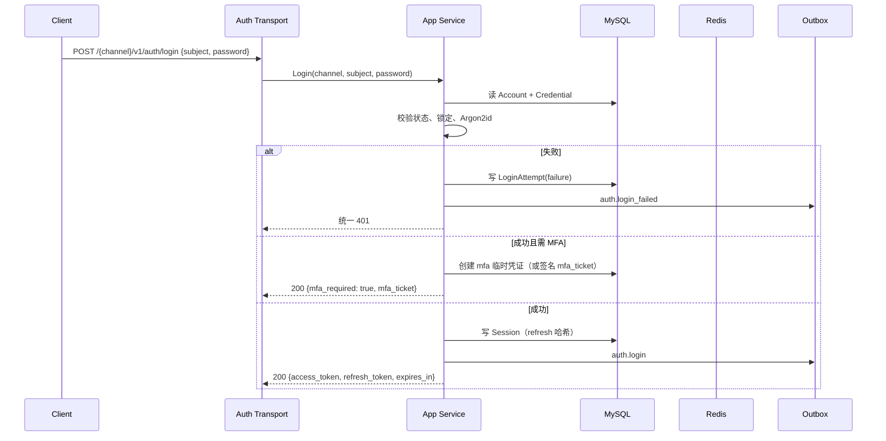
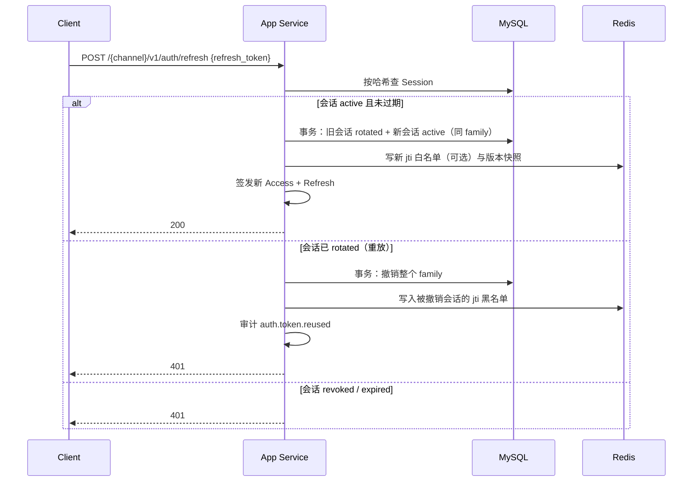

# 身份域与令牌生命周期（Identity & Authentication）

> **状态**：设计生效（v0.1，2026-10-23）；`ENT-01` 阶段 1（账号域）/ 阶段 2（令牌闭环）已完成
> **定位**：定义账号域、凭据、会话、令牌签发与撤销、A 端 MFA、三端认证契约；解决「只有验签、没有登录」的上线阻断问题
> **适用范围**：`internal/identity/`、`internal/security/`、`internal/shared/{auth,audit,apperr}`、`internal/platform/`、`pkg/{jwt,totp,password,crypto,redis,sms}`、`cmd/`、`migrations/`、`api/openapi/`、`scripts/ci/`、`docs/`
> **关联**：[`production-readiness-gaps.md`](./production-readiness-gaps.md) `ENT-01`、[`production-readiness-implementation-plan.md`](./production-readiness-implementation-plan.md) `ENT-01`、[`ARCHITECTURE.md`](./ARCHITECTURE.md) §10、[`rbac-iam.md`](./rbac-iam.md)、[`SECURITY_STANDARDS.md`](./SECURITY_STANDARDS.md) `SEC-04`、[`API_STANDARDS.md`](./API_STANDARDS.md)、[`CONFIG_STANDARDS.md`](./CONFIG_STANDARDS.md)、[`DATA_STANDARDS.md`](./DATA_STANDARDS.md)、[`AUDIT_STANDARDS.md`](./AUDIT_STANDARDS.md)、[`TESTING_STANDARDS.md`](./TESTING_STANDARDS.md)、[`RELIABILITY_STANDARDS.md`](./RELIABILITY_STANDARDS.md)、[`docs/audit/EVENTS.md`](./audit/EVENTS.md)
> **最后更新**：2026-10-23
> **变更方式**：调整领域模型、撤销语义、表结构或验收标准须同步更新 [`production-readiness-implementation-plan.md`](./production-readiness-implementation-plan.md) 与 [`production-readiness-gaps.md`](./production-readiness-gaps.md)，经架构 Owner 与安全 Reviewer 评审后合入

---

## 目录

1. [结论与范围](#一结论与范围)
2. [现状评估](#二现状评估)
3. [领域模型](#三领域模型)
4. [令牌模型与密钥轮换](#四令牌模型与密钥轮换)
5. [登录、刷新与登出](#五登录刷新与登出)
6. [撤销与会话失效](#六撤销与会话失效)
7. [A 端 MFA 与 SSO](#七a-端-mfa-与-sso)
8. [C 端登录](#八c-端登录)
9. [数据模型与迁移](#九数据模型与迁移)
10. [配置规划](#十配置规划)
11. [审计事件](#十一审计事件)
12. [接口契约](#十二接口契约)
13. [平台接入与分层](#十三平台接入与分层)
14. [任务拆解](#十四任务拆解)
15. [验收标准与用例](#十五验收标准与用例)
16. [门禁](#十六门禁)
17. [风险与回滚](#十七风险与回滚)
18. [实施阶段与状态](#十八实施阶段与状态)

---

## 一、结论与范围

### 1.1 结论

平台当前只具备**令牌校验侧**能力：`internal/security` 可验证 HS256 / RS256、`iss` / `aud` / `exp`，但没有任何账号实体、登录端点或会话失效手段。令牌一旦签发，在过期前无法撤销，无法接入真实用户。

`ENT-01` 要补齐的是「身份域是平台底座的一部分」，不是业务功能：

- 账号、凭据、会话、MFA、登录审计由 `internal/identity` 承载；
- 角色 / 权限 / 数据范围仍由 IAM 承载，两张表不互相复制；
- 令牌只表达「你是谁」，不表达「你能做什么」（避免撤权滞后）。

### 1.2 范围

| 纳入 | 说明 |
|---|---|
| 账号域 | `Account`、`Credential`、`Session`、`MFAEnrollment`、`LoginAttempt` 与状态机 |
| 三端令牌 | Access JWT + 一次性 Refresh Token；三端 issuer / audience / 密钥隔离 |
| 生命周期 | 登录、刷新、登出、单会话撤销、全端撤销、账号禁用 / 锁定 |
| 撤销 | 账号级 `token_version` + 单会话 `jti` 黑名单 |
| A 端 | TOTP MFA、会话管理；OIDC / SSO 预留接口与开关 |
| C 端 | 短信验证码登录、OAuth 授权码登录；防枚举、防刷 |
| 审计 | 登录、登出、刷新、重放、撤销、MFA、锁定事件的 Outbox 落库 |

| 不纳入 | 原因 |
|---|---|
| 自建完整 IdP、用户目录同步 | 优先复用组织 OIDC；身份域只做账号映射与会话策略 |
| 角色 / 权限判定 | 归 IAM；令牌不固化角色 |
| 账号自助注册的风控体系 | 仅提供可开关的 C 端自动建号与基础限流 |
| 短信 / OAuth 供应商选型 | 复用 `pkg/sms` 与标准 OAuth2 客户端，供应商由配置决定 |

---

## 二、现状评估

### 2.1 能力盘点

| 维度 | 现状 | 证据 |
|---|---|---|
| 令牌校验 | 支持 HMAC / RSA、多密钥轮换校验、`iss` / `aud` / `exp` / `leeway`；跨端 `channel` 声明校验 | [`jwt.go`](../internal/security/jwt.go)、[`manager.go`](../pkg/jwt/manager.go) |
| 令牌签发 | `pkg/jwt.Manager.Sign` 可用；无 `kid` 头、无对外签发端点 | [`manager.go`](../pkg/jwt/manager.go#L181-L204) |
| 账号域 | 不存在；`Principal` 只有 `SubjectID` / `MerchantID` / `Roles` | [`principal.go`](../internal/shared/auth/principal.go#L30-L36) |
| 认证端点 | 三端 `register.go` 均未注册 `/auth/*`，OpenAPI 无认证契约 | [`admin/register.go`](../cmd/admin-api/register.go) |
| 密码 | Argon2id / bcrypt，支持透明重哈希 | [`hasher.go`](../pkg/password/hasher.go) |
| 撤销 | 无 | — |
| MFA | 无 | — |
| C 端登录 | 无；`pkg/sms` 仅提供发送契约 | [`sms`](../pkg/sms/doc.go) |
| 会话存储 | 无；`pkg/redis` 提供 Cache / Lock / 原生客户端 | [`client.go`](../pkg/redis/client.go) |
| 审计 | `audit.Event` 与 `auth.login` / `auth.login_failed` 已定义，仅写结构化日志 | [`event.go`](../internal/shared/audit/event.go)、[`actions.go`](../internal/shared/audit/actions.go) |
| 异步 | `platform.AsyncRuntime` + `pkg/outbox` 可用，可作为审计可靠出口 | [`async.go`](../internal/platform/async.go) |
| 配置 | 无 `identity.*`；`auth.jwt` 只有验签参数 | [`config.go`](../internal/platform/config.go#L375-L398) |
| 迁移 | `000001`～`000010` 已占用 | `migrations/` |
| 门禁 | 无 `check-authn.sh` | `scripts/ci/`、`Makefile` |

### 2.2 复核命令

```bash
# 1. 确认无身份域与认证端点
rg -n "internal/identity|/auth/login|/auth/refresh|/auth/logout" internal cmd api || true

# 2. 确认验签中间件与 JWT 配置
rg -n "NewJWTAuth|RevocationChecker|active_kid" internal pkg

# 3. 确认迁移编号占用
ls migrations | sed -n 's/^\([0-9]\{6\}\)_.*/\1/p' | sort -u

# 4. 确认幂等 / 限流 / Outbox 可复用原语
rg -n "func .*Cache\)|func .*Lock\)|AsyncRuntime" pkg/redis internal/platform
```

### 2.3 关键结论

1. **可复用原语已齐备**，`ENT-01` 不需要引入新的基础设施。
2. **缺口集中在领域与应用层**：账号实体、会话表、令牌签发编排、撤销检查。
3. **装配顺序需要调整**：撤销检查必须在 `AuthMW` 构造前注入（见 §13）。
4. **迁移编号必须顺延**：原计划使用的 `000009` 已被 `ENT-03` 占用，身份表实际使用 `000011`。

---

## 三、领域模型

包路径：`internal/identity/{domain,app,infrastructure,transport}`。领域层不依赖框架、数据库与 `internal/platform`。

### 3.1 聚合与实体

| 实体 | 关键字段 | 不变量 |
|---|---|---|
| `Account` | `ID`、`Channel`、`Subject`、`Status`、`TokenVersion`、`MerchantID`、`PasswordUpdatedAt`、`DeletedAt` | `(channel, subject)` 全局唯一；`token_version ≥ 1` 且只增不减；禁用账号任何登录路径均拒绝 |
| `Credential` | `AccountID`、`Type`、`Hash`、`Algorithm`、`UpdatedAt` | 同一账号同一类型仅一条有效凭据；只存哈希，不存明文 |
| `Session` | `ID`、`AccountID`、`FamilyID`、`RefreshHash`、`Status`、`TokenVersion`、`ExpiresAt`、`RevokedAt`、`RevokedReason` | `RefreshHash` 全局唯一；`rotated` 会话不可再次使用；同一 `FamilyID` 共享撤销量 |
| `MFAEnrollment` | `AccountID`、`SecretCiphertext`、`ConfirmedAt`、`RecoveryCodeHashes` | 未确认的绑定不得用于登录；密钥必须加密存储 |
| `LoginAttempt` | `Channel`、`AccountRef`、`Outcome`、`Reason`、`IPHash`、`UAHash`、`OccurredAt` | 不存明文手机号 / 邮箱 / 密码；保留期遵循审计策略 |

`AccountRef` 为 `subject` 的规范化哈希或不可逆标识，用于失败计数与审计关联，禁止直接落明文。

### 3.2 账号状态机

```text
pending ──激活──► active ──失败阈值──► locked ──到期/解锁──► active
   │                 │                    │
   └──拒绝/清理──► disabled ◄──管理员停用─┘
```

| 迁移 | 触发 | 副作用 |
|---|---|---|
| `pending → active` | 首次密码 / 验证码 / OAuth 登录成功且策略允许 | 初始化 `token_version=1` |
| `active → locked` | 窗口内失败次数达到 `identity.lockout.max_failures` | 写 `auth.account.locked`；拒绝签发令牌 |
| `locked → active` | 锁定到期或管理员解锁 | `login_attempt` 计数清零 |
| `active / locked → disabled` | 管理员停用 | `token_version++`、撤销全部会话、写 `auth.account.disabled` |
| `disabled → active` | 管理员恢复 | 不恢复旧会话；用户必须重新登录 |

**状态迁移必须有表驱动用例**：合法迁移成功、非法迁移返回稳定错误、每次迁移产生预期审计事件。

### 3.3 会话状态机

```text
active ──刷新──► rotated
  │                 │
  ├──登出/撤销──► revoked
  └──到期──────► expired
```

- 刷新只允许 `active → rotated`，并在同一事务内创建新会话（同一 `FamilyID`）。
- 已 `rotated` 的刷新令牌再次出现，视为重放：整个 `FamilyID` 置 `revoked`，可配置是否同时 `token_version++`。
- `revoked` / `expired` 会话永不复活。

### 3.4 领域错误

领域层返回稳定哨兵错误，由应用层映射为 `internal/shared/apperr`：

| 场景 | 语义 | 对外码 |
|---|---|---|
| 账号不存在 / 密码错误 / 验证码错误 | 统一「认证失败」，不区分原因 | `40100` |
| 账号锁定 / 禁用 | 认证失败，审计记录真实原因 | `40100` |
| MFA 未完成 | 认证未完成，返回 `mfa_required` | `40100` |
| 刷新令牌重放 | 会话撤销 | `40100` |
| 登录 / 发送验证码超限 | 限流 | `42900` |
| 撤销存储不可用（`fail_closed`） | 依赖不可用 | `50300` |

---

## 四、令牌模型与密钥轮换

### 4.1 Access Token

| 声明 | 来源 | 说明 |
|---|---|---|
| `sub` | `Account.ID` | 稳定主体 ID，不随渠道变化 |
| `iss` | `auth.jwt.issuer` | 身份域统一 issuer；三端通过 audience / 密钥隔离 |
| `aud` | `auth.jwt.audience` | 必须只包含本端 channel，跨端令牌 401 |
| `iat` / `exp` | 签发时间 / `identity.access_ttl` | 默认 15 分钟 |
| `jti` | 雪花 ID 或随机 ULID | 单会话撤销与重放检测的键 |
| `ver` | `Account.TokenVersion` | 账号级撤销；校验时与 Redis / DB 比较 |
| `channel` | 进程 channel | 与 `aud` 双重校验 |
| `merchant_id` | `Account.MerchantID` | 仅 B 端携带 |
| `roles` | **禁止签发** | 角色由 IAM 快照解析，避免撤权滞后 |

签发约束：

- `exp - iat` 必须等于配置值，禁止由调用方任意指定。
- 同一账号同一时刻可存在多个 `jti`（多设备）；单会话撤销只影响对应 `jti`。
- 令牌原文禁止进入日志、Trace、指标标签与审计 `attrs`。

### 4.2 Refresh Token

- 32 字节密码学随机数，Base64URL 编码，不携带业务语义，不使用 JWT。
- 出参只出现一次；库内仅存 SHA-256 哈希，按哈希比较，避免时序侧信道。
- 前缀区分端别（如 `ar_` / `br_` / `cr_`），便于日志排查时识别类型而不泄露内容。
- 默认有效期 168 小时（`identity.refresh_ttl`）；支持 `session.idle_timeout` 绝对空闲上限。

### 4.3 密钥环与 `kid`

现状 `pkg/jwt` 不支持 `kid` 头。`T4` 需要扩展：

```yaml
auth:
  mode: jwt
  jwt:
    alg: RS256
    issuer: https://identity.example.com
    audience: [admin]
    active_kid: "2026-10"
    leeway: 30s
    keys:
      - kid: "2026-10"
        public_key_file: /etc/admin-frame/jwt-2026-10.pub.pem
        private_key_file: /etc/admin-frame/jwt-2026-10.key.pem  # 仅签发进程挂载
      - kid: "2026-07"
        public_key_file: /etc/admin-frame/jwt-2026-07.pub.pem
```

规则：

- 签发只在 header 写入 `active_kid`；校验按 `kid` 选中密钥，未知 `kid` 直接失败（不遍历猜测）。
- 轮换期同时保留新旧公钥；旧私钥卸载后，旧令牌自然过期即完成切换。
- HS256 保留 `secret` / `secrets` 兼容路径，但生产推荐 RS256；同一进程不得同时使用两种算法签发。
- `internal/security.JWTConfig` 增加 `ActiveKID`、`Keys`，并保持旧字段可用（弃用标注）；`Validate` 校验 `active_kid` 必须存在于 `keys`，签发进程必须能读取私钥。

### 4.4 三端隔离

| 端 | audience | issuer | 密钥 |
|---|---|---|---|
| A 端 | `admin` | 身份域统一 issuer | 独立密钥对 |
| B 端 | `biz` | 同上 | 独立密钥对 |
| C 端 | `c` | 同上 | 独立密钥对 |

- 任一端的密钥泄露不得影响其他端。
- 校验端同时检查 `aud` 与 `channel` 声明；两者任一不匹配均 `40100`。
- 禁止用 A 端令牌访问 B/C 端（`AC-ENT-01-3`）。

---

## 五、登录、刷新与登出

### 5.1 登录（密码，A/B 端）



要点：

- 账号不存在与密码错误返回同一文案、同一状态码、近似耗时，防枚举。
- 失败计数按 `(channel, account_ref)` 累计；达到阈值转 `locked`，写审计。
- 登录成功后若 `NeedsRehash` 为真，在事务内透明升级密码哈希。
- 登录失败不创建会话；成功但需 MFA 时也不创建正式会话，只返回短期票据。

### 5.2 刷新



约束（`AC-ENT-01-2`）：

1. 刷新令牌**一次性使用**：每次刷新都轮换，旧令牌立即失效。
2. 并发刷新使用数据库行锁或乐观锁；只有一个请求成功，其余按重放处理。
3. 重放触发**整条会话链**撤销，并记录 `auth.token.reused`，而不是只拒绝当前请求。
4. 刷新不改变 `token_version`；仅登出全部 / 禁用 / 改密才递增。

### 5.3 登出

- 默认 `logout`：撤销当前会话（`status=revoked`），把当前 Access 的 `jti` 写入 `authn:revoked:<jti>`，TTL 为令牌剩余寿命。
- `logout_all`：递增 `token_version`、撤销该账号全部会话，写 `authn:ver:<account_id>`。
- 登出幂等：重复登出返回 204，不产生额外审计噪声（或记 `auth.logout` 一次）。

### 5.4 会话边界

- 单账号活跃会话数受 `identity.session.max_per_account` 限制；超限时按最久未使用淘汰并记审计。
- 会话列表只返回 `session_id`、创建时间、最后使用时间、IP / UA 摘要、状态，不返回令牌。
- 管理员撤销会话只需 `session_id`，不接触令牌原文。

---

## 六、撤销与会话失效

### 6.1 Redis 键设计

| 键 | 值 | TTL | 用途 |
|---|---|---|---|
| `authn:ver:<account_id>` | `token_version` | `access_ttl + leeway`（下限 1h） | 账号级撤销；校验令牌 `ver` 是否小于当前值 |
| `authn:revoked:<jti>` | `1` | 令牌剩余寿命 | 单会话撤销 |

- 所有键统一带环境前缀（复用 `pkg/redis` 的 `KeyPrefix`），跨环境互不影响。
- 写入使用 `SET ... EX`；撤销检查只读，不延长 TTL。
- 版本读取未命中时回源数据库并回填短 TTL；禁止因未命中直接放行（必须先回源）。

### 6.2 校验链路

`internal/security` 定义消费侧接口（`S-07`）：

```go
// RevocationChecker 由身份域实现，security 只依赖该接口。
type RevocationChecker interface {
    Check(ctx context.Context, claims jwt.Claims) error
}
```

- `NewJWTAuth` 增加 `WithRevocationChecker` 选项；在签名 / `iss` / `aud` / `exp` 通过后执行。
- 返回 `apperr.ErrUnavailable` 时中间件输出 `50300`；返回 `ErrUnauthorized` 时输出 `40100`。
- 校验顺序：签名 → 时间 → issuer / audience / channel → 账号状态 → `token_version` → `jti` 黑名单。
- 撤销检查结果不得使用长 TTL 进程内缓存；如需缓存，上限 5 秒且必须可主动失效。

### 6.3 失效时限

| 场景 | 生效路径 | 目标时限 |
|---|---|---|
| 单会话登出 | `authn:revoked:<jti>` | 下一次请求立即生效 |
| 账号禁用 | DB `token_version++` + `authn:ver` + 撤销全部会话 | ≤ 60s（`AC-ENT-01-1`） |
| 修改密码 | 同账号禁用 | ≤ 60s |
| 刷新令牌重放 | 撤销 family | 下一次刷新立即生效 |
| 角色 / 权限变更 | IAM 快照失效（不属本域） | 既有 IAM 语义 |

### 6.4 故障策略

- `identity.revocation.failure_mode=fail_closed`：Redis 不可用返回 `50300`，禁止放行；生产强制。
- `fail_open` 仅允许非生产环境，且需在配置评审中说明；启动时 `Validate` 拒绝生产使用。
- 数据库不可用同样失败关闭；禁止「读不到账号就当作有效」。

---

## 七、A 端 MFA 与 SSO

### 7.1 TOTP

- 新增 `pkg/totp`：HMAC-SHA1、30 秒步长、6 位、允许 ±1 个窗口；仅依赖标准库，不引入第三方。
- 密钥生成 20 字节随机数，Base32 展示；数据库存 **AES-GCM 密文**，密钥来自 `identity.mfa.secret_key`（非生产）或 ENT-07 密钥托管（生产）。
- 恢复码一次性使用，仅存哈希；使用后立即失效。
- 绑定流程：`mfa/setup` 返回密钥与 `otpauth://` URI → `mfa/verify` 校验首个动态码 → 标记 `confirmed_at` → 写 `auth.mfa.bound`。

### 7.2 两步登录

- 密码校验通过且账号已绑定 MFA：返回 `200 {"mfa_required": true, "mfa_ticket": "..."}`。
- `mfa_ticket` 是短期 JWT：`aud=admin`、`scope=mfa`、`exp=5m`、`jti` 独立；只允许调用 `mfa/verify`。
- `mfa/verify` 校验票据与动态码后签发正式 Access / Refresh。
- `identity.mfa.admin_required=true` 时：
  - 未绑定 MFA 的 A 端账号登录返回「需要绑定」的稳定错误，不签发管理令牌；
  - 已绑定但两步未完成，绝不签发管理令牌（`AC-ENT-01-4`）。
- `mfa_ticket` 重放：一次性消费（Redis `SETNX`），失败次数计入锁定。

### 7.3 SSO / OIDC 预留

- 定义 `OIDCProvider` 接口：`AuthURL(state, nonce, codeChallenge)`、`Exchange(code, verifier)`、`VerifyIDToken`。
- 流程固定：state + nonce + PKCE；state 存 Redis（TTL 10 分钟，一次性）。
- 账号映射：`(provider, provider_subject) → account_id`；找不到时按 `identity.oauth.auto_provision` 决定拒绝或建号。
- `T8` 只交付接口、配置与禁用态路由；具体 IdP 适配待组织选定后另立任务，不阻塞 `ENT-01` 关闭。

---

## 八、C 端登录

### 8.1 短信验证码

- `POST /c/v1/auth/sms/send`：6 位数字验证码，Redis 存哈希，TTL 5 分钟。
- 限制：
  - 单手机号 60 秒内只能发送一次；
  - 单手机号每日上限、单 IP 每小时上限（`identity.sms.*`）；
  - 验证码最多尝试 5 次，超限作废并记审计；
  - 响应恒定（无论手机号是否存在），防枚举。
- 日志与审计禁止出现完整手机号；只记录不可逆摘要。

### 8.2 OAuth 授权码

- `POST /c/v1/auth/oauth/{provider}/callback`（或等价回调端点）：code + state → 换取 token → 校验 → 映射账号。
- state / PKCE 存 Redis，一次性消费；provider 未配置时不注册路由。
- 账号映射表 `identity_oauth_identity`，`UNIQUE(provider, provider_subject)`。
- 自动建号受 `identity.oauth.auto_provision` 控制，默认关闭。

### 8.3 限流与防刷

| 端点 | 分桶键 | 默认 |
|---|---|---|
| 登录 | `channel + subject 摘要 + IP` | 1 rps / burst 5 |
| 发送验证码 | `channel + 手机号摘要 + IP` | 每 60s 1 次 |
| 刷新 | `channel + session 摘要` | 5 rps / burst 10 |
| MFA 校验 | `channel + account + IP` | 1 rps / burst 5 |

认证端点不挂全局 `AuthMW`，但必须挂独立限流中间件；限流命中返回 `42900`。

---

## 九、数据模型与迁移

### 9.1 迁移

- 文件：`migrations/000011_create_identity_tables.{up,down}.sql`。
- 编号说明：`000009` / `000010` 已被 `ENT-03` 的 `async_outbox` 占用，`ENT-01` 顺延为 `000011`；实施计划中的旧编号须同步修正。
- 只由 `cmd/migrate` 或部署 Job 执行；API / worker 启动只校验版本，不执行迁移（`DATA_STANDARDS`）。

### 9.2 表结构

| 表 | 主键 | 关键唯一键 / 索引 | 说明 |
|---|---|---|---|
| `identity_account` | `id BIGINT` | `UNIQUE(channel, subject)`；`INDEX(channel, status)` | 账号状态与 `token_version` |
| `identity_credential` | `id BIGINT` | `UNIQUE(account_id, credential_type)` | 密码 / 手机号绑定；只存哈希 |
| `identity_session` | `id BIGINT` | `UNIQUE(refresh_token_hash)`；`INDEX(account_id, status)`；`INDEX(family_id)` | 刷新会话链 |
| `identity_mfa` | `account_id BIGINT` | 主键即账号 | TOTP 密文、恢复码哈希 |
| `identity_login_attempt` | `id BIGINT` | `INDEX(channel, account_ref, occurred_at)` | 失败计数与审计关联 |
| `identity_oauth_identity` | `id BIGINT` | `UNIQUE(provider, provider_subject)` | 外部身份映射 |

通用约束：

- 时间列统一 `DATETIME(3)`，应用写入 UTC；`created_at` / `updated_at` 必填。
- 字符集 / 排序规则与现有表一致：`utf8mb4` / `utf8mb4_0900_ai_ci`。
- 主键使用雪花 ID（`pkg/id`），禁止自增。
- 软删使用 `deleted_at`；唯一键须保证软删后标识不可复用（账号 `subject` 不复用）。
- 外键仅用于阻止悬空会话与凭据（`RESTRICT`）；会话清理走独立保留期任务，不在 API 进程执行。
- 密码哈希、刷新哈希长度预留 ≥ 255；TOTP 密文使用 `VARBINARY` 或 `TEXT`。

### 9.3 保留与清理

- `identity_login_attempt` 保留期与审计策略一致，默认 180 天，由独立任务清理。
- `identity_session` 过期记录保留 30 天后清理；清理任务不得删除 `revoked` 状态未满保留期的记录。
- 不在 API 进程内做批量删除；清理逻辑由 worker 或独立 Job 执行。

---

## 十、配置规划

### 10.1 配置结构

```yaml
auth:
  mode: jwt
  expected_channel: admin
  jwt:
    alg: RS256
    issuer: https://identity.example.com
    audience: [admin]
    active_kid: "2026-10"
    leeway: 30s
    keys:
      - kid: "2026-10"
        public_key_file: /etc/admin-frame/jwt-2026-10.pub.pem
        private_key_file: /etc/admin-frame/jwt-2026-10.key.pem

identity:
  enabled: true
  access_ttl: 15m
  refresh_ttl: 168h
  session:
    idle_timeout: 72h
    max_per_account: 10
  revocation:
    driver: redis              # redis 为生产唯一实现
    failure_mode: fail_closed  # fail_closed|fail_open
  password:
    min_length: 12
    max_length: 128
    require_complexity: true
  lockout:
    max_failures: 5
    window: 15m
    duration: 15m
  mfa:
    admin_required: true
    issuer: AdminFrame
    secret_key: ""             # 仅非生产；生产走 ENT-07 密钥托管
  login_rate_limit:
    rps: 1
    burst: 5
  sms:
    enabled: false
    code_ttl: 5m
    max_attempts: 5
    resend_interval: 60s
    daily_per_phone: 10
    hourly_per_ip: 30
  oauth:
    auto_provision: false
    providers: []              # [{name, client_id, client_secret_env, auth_url, token_url, scopes}]
```

### 10.2 校验规则

| 场景 | 规则 |
|---|---|
| 枚举 | `revocation.driver` 仅 `redis`；`failure_mode` 仅 `fail_closed` / `fail_open` |
| 范围 | `access_ttl ∈ [5m, 1h]`；`refresh_ttl > access_ttl`；`idle_timeout > 0`；`max_failures ≥ 1` |
| 必填 | `identity.enabled=true` 时 `auth.mode` 必须为 `jwt`，且 `auth.jwt.active_kid` 存在 |
| 生产强制 | `auth.mode=jwt`；`identity.enabled=true`；`revocation.driver=redis`；`revocation.failure_mode=fail_closed`；A 端 `mfa.admin_required=true` |
| 生产禁止 | `auth.mode=demo`；`failure_mode=fail_open`；`sms.enabled=false` 且 `oauth.providers` 为空（C 端无可用登录方式） |
| 密钥 | `secret_key` 不得写入示例配置；生产 `identity.mfa.secret_key` 为空时必须由密钥托管注入 |
| 脱敏 | `LogValue` 输出 `secret_key` 为掩码；provider `client_secret` 只输出是否配置 |

环境变量前缀统一 `ADMIN_FRAME_IDENTITY_<SECTION>_<KEY>`（如 `ADMIN_FRAME_IDENTITY_REVOCATION_FAILURE_MODE`）。

---

## 十一、审计事件

### 11.1 事件目录

复用 `internal/shared/audit` 的 `Event` 与 `Outcome`；事件名沿用现有 `auth.` 前缀。

| 事件 | 触发 | 关键字段 | 说明 |
|---|---|---|---|
| `auth.login` | 登录成功 | `actor_id`、`channel`、`merchant_id`、`trace_id` | 不记录令牌 |
| `auth.login_failed` | 登录失败 | 同上 + `reason`（`bad_credential` / `locked` / `disabled` / `mfa_pending`） | 文案对外统一 |
| `auth.logout` | 登出 / 会话撤销 | `actor_id`、`session_id` 摘要 | 幂等 |
| `auth.token.refresh` | 刷新成功 | `actor_id`、`family_id` 摘要 | 不记录令牌 |
| `auth.token.reused` | 刷新令牌重放 | 同上 + `reason=reuse_detected` | 触发整链撤销 |
| `auth.token.revoked` | 单会话 / 全端撤销 | `actor_id`、`session_id` 摘要 | 含管理员操作 |
| `auth.mfa.bound` | MFA 绑定完成 | `actor_id` | 不记录密钥 / 恢复码 |
| `auth.mfa.failed` | MFA 校验失败 | `actor_id`、`reason` | 计入锁定 |
| `auth.account.locked` | 达到失败阈值 | `actor_id`、`channel` | 由系统触发 |
| `auth.account.disabled` | 管理员停用账号 | 操作人 + 目标账号 | 同时撤销会话 |

### 11.2 落库与一致性

- 审计写入与账号 / 会话写入必须**同一事务**：复用 IAM 的 UnitOfWork + `async_outbox` 模式（`topic=audit.event`）。
- 内存模式（`db.driver=memory`）允许退化为直接 `SlogEmitter`，仅限 local / test。
- 审计失败时认证关键写入必须回滚（失败关闭）；禁止「登录成功但审计丢失」。
- 事件不得包含令牌、密码、验证码、完整手机号、TOTP 密钥、恢复码。
- 同步更新 [`docs/audit/EVENTS.md`](./audit/EVENTS.md) 与 `internal/shared/audit/actions.go`；新增 action 必须进入 `KnownActions()` 并由单测固定。

---

## 十二、接口契约

### 12.1 端点清单

| 端 | 方法与路径 | 认证 | 说明 |
|---|---|---|---|
| A/B/C | `POST /{端}/v1/auth/login` | 无 | 密码（A/B）或手机号 + 验证码（C） |
| A/B/C | `POST /{端}/v1/auth/refresh` | 无（凭刷新令牌） | 一次性轮换 |
| A/B/C | `POST /{端}/v1/auth/logout` | Bearer | 撤销当前会话 |
| A/B | `POST /{端}/v1/auth/logout-all` | Bearer | 递增 `token_version` |
| A | `POST /admin/v1/auth/mfa/setup` | Bearer | 生成 TOTP 密钥 |
| A | `POST /admin/v1/auth/mfa/verify` | 无（凭 `mfa_ticket`） | 完成两步登录或绑定确认 |
| A | `POST /admin/v1/auth/mfa/disable` | Bearer | 解绑（需二次验证） |
| A | `GET /admin/v1/auth/sessions` | Bearer | 列出本账号会话 |
| A | `DELETE /admin/v1/auth/sessions/{id}` | Bearer | 撤销指定会话 |
| A | `POST /admin/v1/auth/sessions/revoke-all` | Bearer | 撤销全部会话 |
| C | `POST /c/v1/auth/sms/send` | 无 | 发送验证码 |
| C | `POST /c/v1/auth/oauth/{provider}/callback` | 无 | 授权码回调 |

### 12.2 请求 / 响应约束

- 登录请求只接受 `subject`（A/B）或 `phone`（C）与凭据；不接受 `channel`、`roles`、`merchant_id` 由客户端指定。
- `merchant_id` 由账号绑定关系推导，B 端令牌不得跨商户。
- 登录响应：`access_token`、`refresh_token`、`token_type=Bearer`、`expires_in`；需 MFA 时只返回 `mfa_required` 与 `mfa_ticket`。
- 错误信封沿用 `httpx` 统一格式；登录失败统一 `40100`，不区分账号不存在 / 密码错误。
- 认证端点必须声明 `Idempotency-Key` 可选策略（写接口），刷新与登出按幂等语义处理。

### 12.3 OpenAPI

- `api/openapi/{admin,biz,c}.yaml` 新增 `auth` tag 与上述 path；组件 schema 放 `components.yaml` 复用。
- `info.version` 提 minor；破坏性调整提 major。
- 错误码至少覆盖 `40000`、`40100`、`42900`、`50300`。
- `check-openapi` 必须通过；新增 `check-authn` 校验三端均存在认证路径。

---

## 十三、平台接入与分层

### 13.1 目录与依赖

```text
internal/identity/
├── domain/          # 聚合、状态机、仓储接口、领域错误
├── app/             # 登录 / 刷新 / 登出 / 撤销 / MFA 用例，事务与审计编排
├── infrastructure/
│   ├── persistence/ # MySQL / 内存仓储
│   ├── cache/       # Redis 撤销与验证码存储
│   └── oauth/       # OAuth / OIDC 适配（预留）
└── transport/
    ├── admin/       # /admin/v1/auth/*
    ├── biz/         # /biz/v1/auth/*
    ├── c/           # /c/v1/auth/*
    └── rest/        # 通道无关 Handler / DTO
```

- `identity` 禁止 import `internal/platform`；`transport` 只依赖 `internal/shared` 与 `pkg/*`。
- `platform` 不得 import `internal/identity`；通过 `cmd` 注入接口。
- 端差异只体现在 `cmd` 装配与 `transport`，领域模型三端共享。

### 13.2 装配顺序

现状 `platform.Run` 先构造 `AuthMW`、后构造 `NewAuthorizer`，撤销检查无法注入。调整为：

```text
配置 → 日志 / 指标 / 追踪 / 存储 / DB / Redis
→ 构造 Deps（不含 AuthMW）
→ NewSessionValidator(deps)（cmd 构造身份运行时，返回撤销检查函数）
→ NewAuthMiddleware(cfg.Auth, channel, env, WithRevocationChecker(...))
→ NewAuthorizer / Register（复用同一身份运行时注册路由）
→ Pipeline → ListenAndServe
```

- `platform.Options` 新增 `NewSessionValidator func(*Deps) (SessionValidator, error)`；`SessionValidator` 为平台侧最小接口，避免反向依赖身份域。
- `cmd/{admin,biz,c}-api` 用 `sync.Once` 构造身份运行时，`NewSessionValidator` 与 `Register` 共享实例（与 IAM 装配方式一致）。
- `auth.Principal` 增加 `SessionID`、`TokenVersion`、`TokenExpiresAt`；`principalFromClaims` 读取 `jti` / `ver`。
- `roles` 声明仅保留兼容读取；签发端不再写入。IAM `shadow` / `enforce` 模式以快照为唯一权限来源。
- 健康检查追加 `identity_db` / `identity_redis`；MS 模式（内存）不注册假检查。

### 13.3 与 IAM 的边界

| 关注点 | 身份域 | IAM |
|---|---|---|
| 账号是否存在、是否可登录 | 负责 | 不感知 |
| 角色 / 权限 / 数据范围 | 不负责 | 负责 |
| 令牌中的 `sub` | 提供 | 作为快照查询键 |
| 禁用 / 锁定 | 负责并撤销会话 | 不负责 |
| 审计事件 | 认证类事件 | 授权 / 角色类事件 |

---

## 十四、任务拆解

| 序号 | 任务 | 产出 | 变更路径 | 验收要点 | 阶段 |
|---|---|---|---|---|---|
| T1 | 身份域建模 | `Account`、`Credential`、`Session`、`MFAEnrollment`、`LoginAttempt` 与状态机 | `internal/identity/domain` | 状态迁移表驱动用例；禁用 / 锁定不可登录 | 1 |
| T2 | 持久化 | 六张表 + 内存 / MySQL 仓储 | `internal/identity/infrastructure/persistence`、`migrations/000011_*` | up/down 可执行；唯一键与索引符合 §9；API 不执行迁移 | 1 |
| T3 | 凭据与策略 | Argon2id、密码强度、失败锁定、登录限流 | `internal/identity/app`、`pkg/password`、`pkg/ratelimit` | 5 次失败锁定；统一文案；审计事件 | 1 |
| T4 | 令牌签发 | Access JWT + 一次性 Refresh；`kid` 密钥环 | `pkg/jwt`、`internal/security`、`internal/identity/app` | 三端隔离；`kid` 轮换；未知 `kid` 拒绝 | 2 |
| T5 | 撤销 | `token_version` + `jti` 黑名单 + `RevocationChecker` | `pkg/redis`、`internal/security`、`internal/platform` | 禁用 / 登出 ≤ 60s；Redis 故障 `50300` | 2 |
| T6 | 认证端点 | 三端 `login` / `refresh` / `logout`；A 端 `sessions` | `internal/identity/transport/*`、`cmd/*/register.go` | OpenAPI 三端契约；刷新重放触发全链撤销 | 2 / 4 |
| T7 | C 端登录 | 短信验证码 + OAuth 回调；防刷 | `internal/identity/infrastructure/cache`、`pkg/sms`、`transport/c` | 防枚举、防刷；验证码 5 分钟过期 | 4 |
| T8 | A 端 MFA / SSO | TOTP、`mfa_ticket`、绑定 / 解绑 / 恢复码；OIDC 预留 | `pkg/totp`、`internal/identity/app`、`transport/admin` | 未完成 MFA 不得获得管理令牌 | 3 |
| T9 | 审计接入 | `auth.*` 事件目录、字段、Outbox 事务 | `internal/shared/audit`、`docs/audit/EVENTS.md`、`internal/identity/app` | 登录 / 登出 / 失败 / 锁定 / MFA / 重放均有事件 | 5 |
| T10 | 与 IAM 边界 | 令牌不携带角色；Principal 增补字段 | `internal/shared/auth`、`internal/security`、`cmd` | IAM 快照为唯一权限来源；撤权即时 | 2 |

**依赖关系**：T1 → T2 → T3 → T4 → T5 → T6；T6 完成后 T8、T7 可并行；T9 与 T10 随 T4/T6 一起合入，T9 在阶段 5 收口。

---

## 十五、验收标准与用例

| AC | 要求 | 用例位置 | 验证命令 |
|---|---|---|---|
| `AC-ENT-01-1` | 账号禁用或登出后 ≤ 60s，旧访问令牌被拒绝 | `internal/identity/app/*_test.go`、`tests/integration/identity/revocation_test.go` | `go test ./internal/identity/... ./internal/security/...`；`make test-integration` |
| `AC-ENT-01-2` | 刷新令牌一次性使用；重放触发撤销并记审计 | `internal/identity/app/refresh_test.go`、`tests/integration/identity/refresh_reuse_test.go` | 同上 |
| `AC-ENT-01-3` | 三端 issuer / audience / 密钥隔离，跨端令牌互不通过 | `internal/security/jwt_keys_test.go`、`internal/identity/app/token_test.go` | `go test ./internal/security/...` |
| `AC-ENT-01-4` | 登录失败限流与锁定生效；A 端未完成 MFA 不得获得管理令牌 | `internal/identity/app/lockout_test.go`、`internal/identity/app/mfa_test.go` | 同上 |
| `AC-ENT-01-5` | 登录、登出、失败、锁定、MFA 绑定均产生审计事件 | `internal/identity/app/audit_test.go`、`docs/audit/EVENTS.md` | `bash scripts/ci/check-audit.sh` |

补充用例要求：

- 每个状态机迁移至少一个表驱动用例，包含非法迁移。
- 所有认证失败用例断言：状态码一致、文案一致、无令牌泄露。
- 集成用例必须使用真实 MySQL + Redis（`TEST_MYSQL_DSN` / `TEST_REDIS_ADDR`），未配置时显式跳过。
- 并发刷新用例：10 个并发请求仅 1 个成功，其余按重放处理并撤销会话链。

---

## 十六、门禁

新增 `scripts/ci/check-authn.sh`，接入 `Makefile` 的 `check-authn` 与 `ci` target：

| 检查 | 规则 |
|---|---|
| 生产配置 | `env=prod` 时禁止 `auth.mode=demo`；强制 `identity.enabled=true`、`revocation.driver=redis`、`revocation.failure_mode=fail_closed`、A 端 `mfa.admin_required=true` |
| 契约 | `api/openapi/{admin,biz,c}.yaml` 均存在 `login` / `refresh` / `logout` path |
| 撤销路径 | `internal/security` 存在 `RevocationChecker` 引用，且有测试文件引用 |
| 迁移 | `000011_create_identity_tables.{up,down}.sql` 成对存在，编号不重复 |
| 审计 | 新增 action 在 `KnownActions()` 与 `EVENTS.md` 同时存在 |
| 密钥 | 示例配置不含明文 `secret_key` / `client_secret` |

门禁必须验证「违规即失败」：在 PR 中提供临时违规样例的失败输出。

---

## 十七、风险与回滚

| 风险 | 影响 | 缓解 | 回滚 |
|---|---|---|---|
| 令牌语义切换导致全端 401 | 用户无法访问 | 先影子校验、按 channel 灰度；新旧密钥并存 | 切回 `auth.mode=demo`（仅非生产）或回退签发逻辑与密钥环 |
| Redis 不可用导致登录 / 鉴权不可用 | 全站不可用 | 连接池隔离、超时、`failure_mode` 可配置 | 安全审批后临时 `fail_open`；恢复后立即切回 |
| 刷新并发导致会话被误撤销 | 用户被登出 | 行锁 / 乐观锁 + 单请求成功语义 | 降低并发窗口、保留审计重放记录 |
| 短信 / OAuth 供应商不稳定 | C 端无法登录 | 超时 + 熔断 + 降级提示；双登录方式 | 关闭该登录方式开关 |
| TOTP 密钥泄露 | A 端账号被接管 | AES-GCM 加密、密钥托管、恢复码一次性 | 强制重置 MFA 并撤销全部会话 |
| 账号迁移遗漏 | 部分用户无法登录 | 导入脚本 + 核对报告 + 只增不删 | 回滚迁移并恢复备份 |
| 审计与业务写入不同事务 | 审计丢失 | 复用 UnitOfWork + `async_outbox`；失败关闭 | 修复事务边界后重放 Outbox |

回滚原则：所有新能力默认关闭；开关关闭后行为回到「只有验签」，不影响已有 IAM 与业务接口。

---

## 十八、实施阶段与状态

| 阶段 | 内容 | 对应任务 | 出口标准 |
|---|---|---|---|
| 0 契约 | 本文档、OpenAPI 骨架、配置字段与 `Validate`、迁移草案、审计 action 目录 | T1/T2/T9 前置 | 文档评审通过；`check-openapi` 通过 |
| 1 账号域 | domain + 仓储 + 密码策略 + 锁定 + 迁移 + 单测 | T1/T2/T3 | 状态机与仓储用例全绿 |
| 2 令牌闭环 | `pkg/jwt` kid / 密钥环、签发、登录 / 刷新 / 登出、撤销 checker、A/B 端点 | T4/T5/T6/T10 | `AC-ENT-01-1/2/3/5` 通过 |
| 3 MFA | TOTP、`mfa_ticket`、会话管理 | T8 | `AC-ENT-01-4` 通过 |
| 4 C 端 | 短信验证码、防刷、OAuth 回调、OIDC 预留 | T6（C）/T7 | C 端登录与限流用例通过 |
| 5 收口 | 审计回写、`check-authn`、全量门禁、真实依赖集成测试、状态回写 | T9/T10 | `make ci` + `make test-integration` 全绿 |

状态：`待做` / `进行中` / `已完成`。每个阶段独立 MR，遵循「一条 ENT 一个主 MR + 契约先合」的合入策略；阶段完成后在本文件与 [`production-readiness-implementation-plan.md`](./production-readiness-implementation-plan.md) 同步状态。

| 阶段 | 状态 |
|---|---|
| 0 契约 | 进行中（本文档） |
| 1 账号域 | 已完成 |
| 2 令牌闭环 | 已完成 |
| 3 MFA | 待做 |
| 4 C 端 | 待做 |
| 5 收口 | 待做 |
